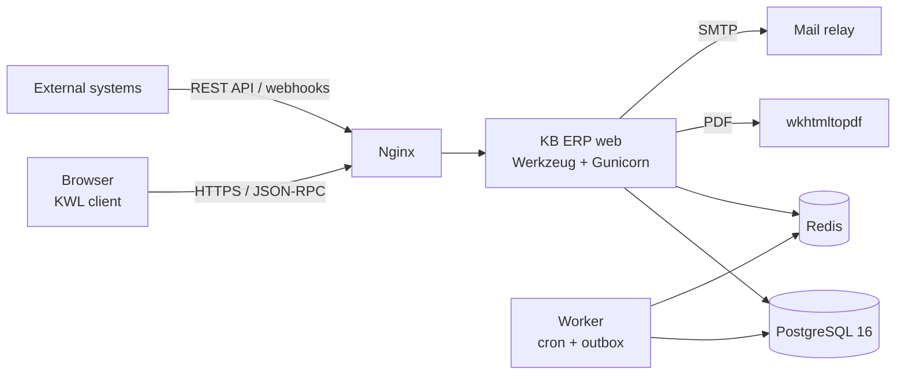
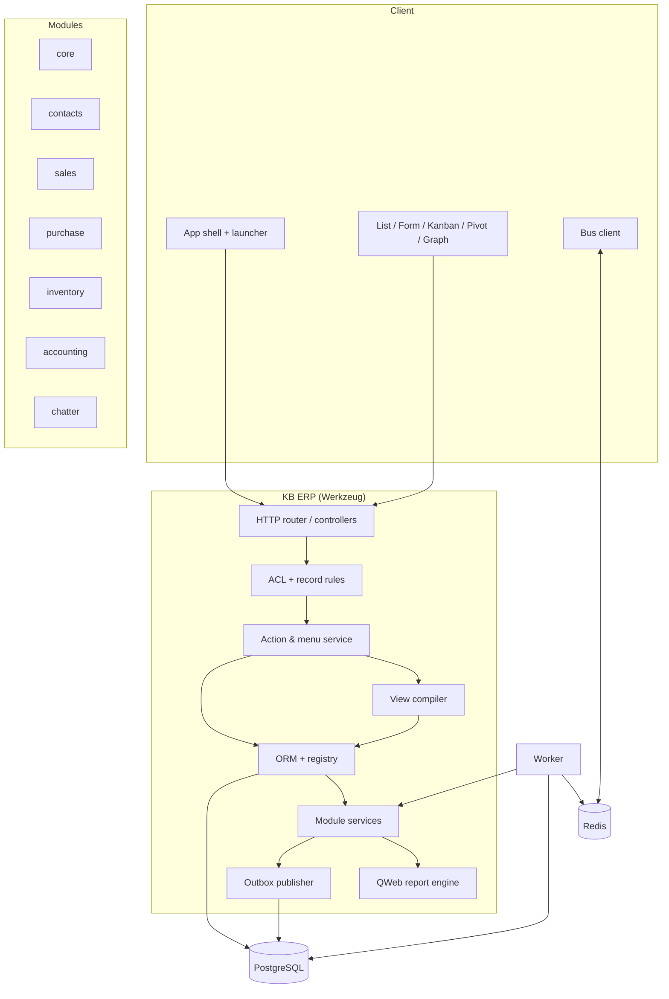
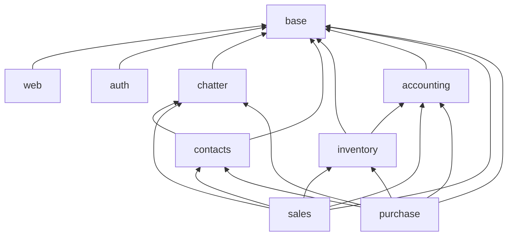
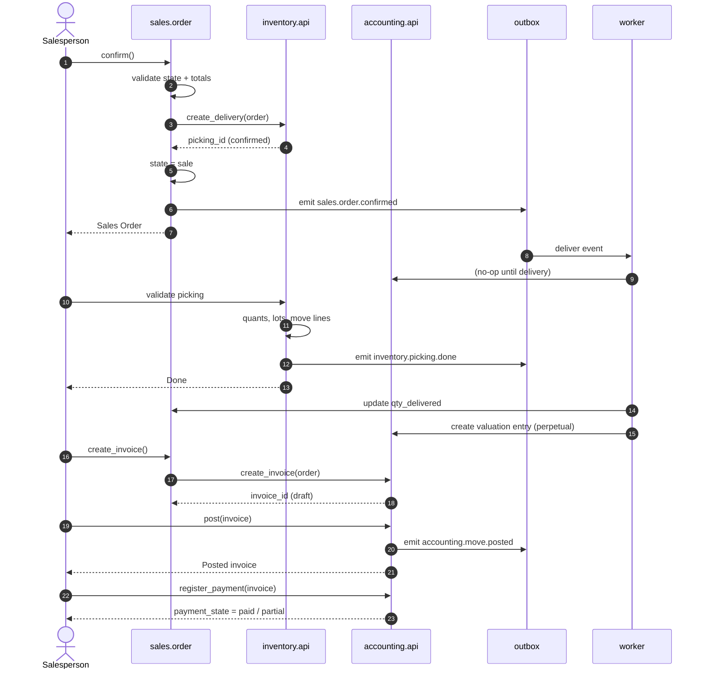
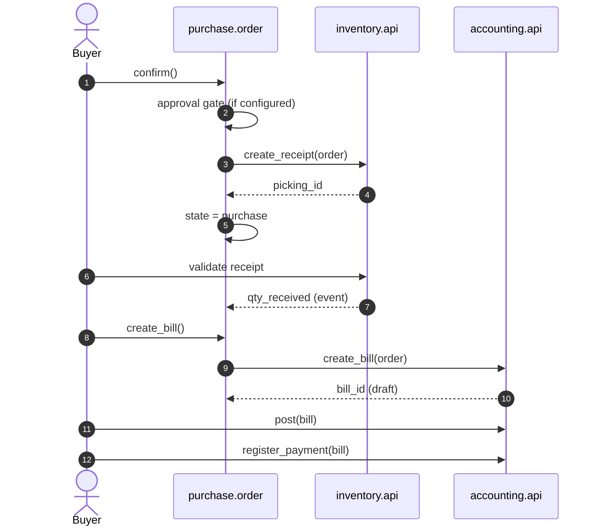
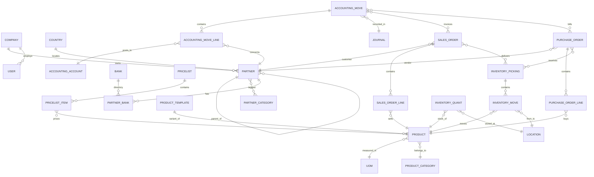

# KB ERP — Architecture

| Field | Value |
|---|---|
| Product | **KB ERP** (`kberp`) |
| Version | 1.0 |
| Scope | Platform + five applications: **Contacts, Sales, Purchase, Inventory, Accounting** |
| Pattern | Modular monolith, Odoo-style module system, schema-per-module, event-assisted integration |
| Reference | Odoo 19 (`19.0-20260619`) behavioural parity |
| Companion documents | [`prd.md`](prd.md) · [`rules.md`](rules.md) · [`design.md`](design.md) · [`phases.md`](phases.md) |

---

## 1. Architectural principles

| # | Principle | Consequence |
|---|---|---|
| AR-1 | **One product, five apps, one database** | A single deployment serves all apps; no distributed transactions |
| AR-2 | **Modular monolith with hard boundaries** | Each module owns a PostgreSQL schema; cross-module access only through services |
| AR-3 | **Metadata-driven UI** | Menus, actions, views and security are XML records loaded into the database |
| AR-4 | **Shared kernel, not shared tables** | Partner, product, company, currency and UoM are first-class kernel entities |
| AR-5 | **Commands are synchronous, side effects are events** | Cross-module writes that must succeed together use one transaction; the rest uses the outbox |
| AR-6 | **Documents are state machines** | Every business document has explicit states and guarded transitions |
| AR-7 | **Server is authoritative** | All validation, permissions, totals and sequences are computed server-side |
| AR-8 | **Odoo-shaped, not Odoo-derived** | Same concepts and navigation; no Odoo code, schema or branding |
| AR-9 | **Everything is auditable** | State changes, postings and permission changes are logged immutably |
| AR-10 | **Boring, replaceable infrastructure** | PostgreSQL, Redis, Werkzeug, Docker; no exotic dependencies |

---

## 2. Reference stack

The stack mirrors Odoo's architecture as requested, implemented independently.

| Layer | Choice | Role | Odoo analogue |
|---|---|---|---|
| Language (server) | Python 3.12 | Models, services, controllers, jobs | Python |
| Web server / WSGI | Werkzeug 3 + Gunicorn | Routing, sessions, request lifecycle | Werkzeug |
| Database | PostgreSQL 16 | ACID store, JSONB, full-text, schemas | PostgreSQL |
| ORM | Own `kberp.orm` | Models, fields, computed fields, domains, recordsets | Odoo ORM |
| Schema changes | Module migrations + generated DDL | Versioned install/upgrade | `ir.model` auto-init |
| View engine | XML → JSON compiler | List/kanban/form/search/pivot/graph | Odoo XML views |
| Templating | QWeb-compatible engine (Jinja2 core) | Reports, portal, email bodies | QWeb |
| UI framework | **KWL** — TypeScript, signal-based components | Reactive client, view renderers | OWL |
| CSS | Bootstrap 5.3 + SCSS tokens | Layout, components, responsiveness | Bootstrap |
| PDF | wkhtmltopdf | Invoices, orders, delivery slips | wkhtmltopdf |
| Bus / realtime | WebSocket + Redis pub/sub | Notifications, long-running jobs | `bus.bus` |
| Queue / scheduler | PostgreSQL outbox + worker + `ir.cron` | Async events, recurring jobs | `ir.cron` |
| Cache | Redis (optional) + in-process LRU | Menus, settings, translations | `ormcache` |
| Auth | Session cookie + Argon2id; OIDC optional | Users, sessions | `res.users` |
| APIs | JSON-RPC (internal) + REST (external) | Client and integrations | JSON-RPC / XML-RPC / REST |
| Reports | QWeb templates + PDF, XLSX export | Documents, analysis | QWeb reports |
| Deployment | Docker Compose, Nginx reverse proxy | Reproducible environments | Docker |

### 2.1 What "Odoo-shaped" means concretely

| Odoo concept | KB ERP equivalent |
|---|---|
| `__manifest__.py` | `module.py` manifest with `depends`, `data`, `assets`, `application`, `sequence` |
| `models.Model` / `_inherit` | `Model` base class; `_inherit` extension registry |
| `fields.Char`, `fields.Many2one` … | `fields.*` with the same semantics (comodel, ondelete, company_dependent) |
| `ir.ui.view` + `inherit_id` + xpath | `core.ir_ui_view`, same inheritance model |
| `ir.ui.menu` | `core.ir_ui_menu` (parent, sequence, action, groups, web_icon) |
| `ir.actions.act_window` | `core.ir_act_window` (res_model, view_mode, domain, context, path) |
| `ir.model.access` / `ir.rule` | identical names and semantics |
| `res.partner` | `core.partner`, exposed by the Contacts app |
| `account.move` | `accounting.move` with `move_type` and `state` |
| `stock.picking` / `stock.move` / `stock.quant` | `inventory.*` equivalents |
| `sale.order` / `purchase.order` | `sales.order` / `purchase.order` |
| `mail.thread` | `chatter.mixin` (messages, followers, activities) |
| `ir.cron` | `core.ir_cron` executed by the worker |

---

## 3. System context



| Actor | Interaction |
|---|---|
| Internal user | Session-authenticated KWL client over JSON-RPC |
| Administrator | Same client, plus Settings and technical screens |
| External system | REST API with API keys, scoped per company |
| Worker | Claims outbox events and cron jobs, never serves HTTP |
| Mail relay | Outbound notifications, invoicing, follow-ups |

---

## 4. Container and component view



---

## 5. Repository layout

```
kberp/
├── pyproject.toml
├── docker-compose.yml
├── Dockerfile
├── alembic.ini
├── src/
│   ├── kberp/
│   │   ├── __main__.py              # Werkzeug entrypoint
│   │   ├── app.py                   # application factory, routes, middleware
│   │   ├── config.py                # env + settings
│   │   ├── orm/                     # registry, fields, model, domain, query
│   │   ├── web/                     # controllers, session, rpc, bus, http helpers
│   │   ├── views/                   # XML parser, xpath inheritance, compiler
│   │   ├── security/                # ACL evaluation, record rules, password hashing
│   │   ├── report/                  # QWeb-compatible engine, PDF/XLSX
│   │   ├── modules/                 # loader, manifest, migrations runner
│   │   └── cli/                     # install, upgrade, seed, backup, shell
│   ├── addons/
│   │   ├── base/                    # core kernel + platform models
│   │   ├── web/                     # shell assets, base views, launcher
│   │   ├── auth/                    # users, groups, sessions
│   │   ├── chatter/                 # mail messages, followers, activities
│   │   ├── contacts/
│   │   ├── sales/
│   │   ├── purchase/
│   │   ├── inventory/
│   │   └── accounting/
│   └── migrations/
│       ├── core/
│       ├── contacts/
│       ├── sales/
│       ├── purchase/
│       ├── inventory/
│       └── accounting/
├── static/                          # built assets (Vite output)
├── tests/
│   ├── unit/
│   ├── integration/
│   ├── contracts/
│   └── e2e/
└── docs/
    ├── prd.md
    ├── architecture.md
    ├── rules.md
    ├── design.md
    └── phases.md
```

### 5.1 Module anatomy

```
addons/sales/
├── module.py                  # manifest: name, version, depends, data, assets, application, sequence
├── __init__.py
├── models/
│   ├── sale_order.py
│   ├── sale_order_line.py
│   └── crm_team.py
├── services/
│   ├── api.py                 # public service interface (typed)
│   ├── order_service.py       # commands and queries
│   └── pricing.py             # pricelist/tax calculation
├── handlers/
│   └── events.py              # subscriptions to inventory/accounting events
├── views/
│   ├── sale_order_views.xml
│   ├── menus.xml
│   └── settings.xml
├── security/
│   ├── groups.xml
│   ├── ir.model.access.xml
│   └── ir.rule.xml
├── data/
│   └── sequences.xml
├── report/
│   ├── sale_order.xml         # QWeb template
│   └── report.xml             # report action
└── tests/
    ├── test_order_flow.py
    └── test_pricing.py
```

---

## 6. Module system

### 6.1 Manifest

```python
# addons/sales/module.py
MANIFEST = {
    "name": "Sales",
    "version": "1.0.0",
    "category": "Sales",
    "sequence": 30,
    "summary": "Quotations, sales orders and invoicing",
    "depends": ["base", "contacts", "chatter", "inventory", "accounting"],
    "data": [
        "security/groups.xml",
        "security/ir.model.access.xml",
        "security/ir.rule.xml",
        "views/sale_order_views.xml",
        "views/menus.xml",
        "data/sequences.xml",
    ],
    "assets": {"web.assets_backend": ["static/src/**/*"]},
    "application": True,
    "web_icon": "sales/static/description/icon.svg",
    "license": "LGPL-3",
}
```

### 6.2 Allowed dependency graph



Rules:

1. Arrows point **down only**; cycles are rejected at install time.
2. `base` never depends on a business module.
3. `contacts` owns the partner UI but the partner **model** lives in `base` (kernel).
4. `sales` and `purchase` never import each other.
5. `inventory` never imports `sales` or `purchase`; it exposes services they call, and calls `accounting.services.api` only for valuation.
6. `accounting` never imports `sales`, `purchase` or `inventory`; they call accounting services.

### 6.3 Install / upgrade lifecycle

```
load manifest
  → validate dependency closure and topological order
  → create/update schema (migrations)
  → load XML data in declared order
  → rebuild registry caches (models, views, menus, rules)
  → register event handlers
  → mark module installed/upgraded (version)
```

Upgrades are **versioned**: `1.0.0 → 1.1.0` runs `migrations/<module>/1.1.0.py`
before XML reload. No destructive DDL is generated automatically.

---

## 7. Core framework

### 7.1 ORM

| Capability | Behaviour |
|---|---|
| Model declaration | `class Partner(Model): _name = "core.partner"; _inherit = [...]` |
| Recordsets | Immutable, chainable, lazily evaluated |
| Fields | `Char, Text, Html, Integer, Float, Monetary, Boolean, Date, Datetime, Selection, Many2one, One2many, Many2many, Binary, Json, Properties` |
| Computed fields | `compute="..."`, `depends=[...]`, `store=True/False`, `inverse="..."` |
| Related fields | `related="partner_id.name"`, `readonly`, `store` |
| Company-dependent | Value stored in `jsonb` keyed by company id (mirrors Odoo `ir.property`) |
| Domain | Safe expression tree compiled to SQL; no raw string interpolation |
| Ordering | `_order` per model; `complete_name asc, id desc` for partners |
| Constraints | `@constraint` (Python) and `@sql_constraint` (DDL) |
| Inheritance | `_inherit` (extension) and `_inherits` (delegation) for the few cases needed |
| Audit | `create_uid`, `create_date`, `write_uid`, `write_date`, `version` on all business tables |

Example:

```python
class SaleOrder(Model):
    _name = "sales.order"
    _order = "date_order desc, id desc"

    name = fields.Char(required=True, copy=False, default=lambda r: r.env.sequence.next("sales.order"))
    partner_id = fields.Many2one("core.partner", required=True, ondelete="restrict")
    partner_invoice_id = fields.Many2one("core.partner", compute="_compute_addresses", store=True)
    state = fields.Selection(
        [("draft", "Quotation"), ("sent", "Quotation Sent"),
         ("sale", "Sales Order"), ("cancel", "Cancelled")],
        default="draft", required=True, tracking=True,
    )
    order_line = fields.One2many("sales.order_line", "order_id", string="Order Lines")
    amount_total = fields.Monetary(compute="_compute_amounts", store=True, currency_field="currency_id")
```

### 7.2 Registry

A single in-process registry holds:

- models and fields (with inheritance applied),
- views (base + inherited, per model/type),
- menus and actions,
- ACLs and record rules,
- settings schema,
- event subscriptions,
- asset bundles.

The registry is rebuilt on install/upgrade and cached per worker process; a
`registry_version` stored in PostgreSQL invalidates workers after upgrades.

### 7.3 View engine

```
XML (module)  →  parse + validate  →  core.ir_ui_view rows
                                        │
                    inheritance (inherit_id + xpath) applied at load
                                        │
                              compiled JSON per (model, view_type)
                                        │
                                   KWL renderer
```

Supported view types: `list`, `form`, `kanban`, `search`, `pivot`, `graph`,
`activity`. Supported xpath positions: `before`, `after`, `inside`, `replace`,
`attributes`.

### 7.4 Menus and actions

```xml
<record model="core.ir_act_window" id="action_quotations">
    <field name="name">Quotations</field>
    <field name="res_model">sales.order</field>
    <field name="view_mode">list,kanban,form</field>
    <field name="domain">[('state','in',['draft','sent'])]</field>
    <field name="context">{'default_state': 'draft'}</field>
    <field name="path">quotations</field>
</record>

<menuitem id="menu_sales_root" name="Sales" sequence="30"
          web_icon="sales/static/description/icon.svg"
          groups="sales.group_sale_user"/>

<menuitem id="menu_orders" name="Orders" parent="menu_sales_root" sequence="1"/>
<menuitem id="menu_quotations" name="Quotations" parent="menu_orders"
          action="action_quotations" sequence="1"/>
```

The client requests `/web/menu/<app>` and receives a filtered tree (by group) plus the
default action. The server never sends menu entries the user cannot open.

### 7.5 Routing and controllers

| Route | Purpose |
|---|---|
| `GET /` | Redirect to `/apps` |
| `GET /apps` | Launcher payload (apps, recent, favourites) |
| `GET /apps/<app>` | App shell; default action redirect |
| `GET /apps/<app>/<path>` | Action view |
| `POST /web/rpc` | JSON-RPC: `call(model, method, args, kwargs)` |
| `GET /web/session` | Current user, companies, groups, settings |
| `GET /web/menu/<app>` | Menu tree |
| `GET /web/views/<model>/<type>` | Compiled view |
| `GET /web/report/<name>/<id>` | PDF/XLSX |
| `POST /web/bus` | WebSocket upgrade (or `/bus` long-poll fallback) |
| `POST /api/v1/...` | External REST API (API key) |

Controllers do three things: authenticate, validate the envelope, dispatch to a
service. **No business logic in controllers.**

### 7.6 KWL client (OWL-style)

| Concern | Design |
|---|---|
| Reactivity | Signals + computed + effect; batched renders |
| Components | Class/functional components with `props`, `state`, `onMounted` |
| Registry | `registry.category("views")`, `"fields"`, `"services"`, `"actions"` |
| Router | History API; route → action → view → record |
| RPC | Typed client with request IDs, retries for idempotent reads |
| Views | `list`, `form`, `kanban`, `search`, `pivot`, `graph`, `activity` |
| State | URL is source of truth for search/filter/group/pagination |
| Offline | Read-only cache of last views; no offline writes |

---

## 8. Shared kernel (`base`)

The kernel owns entities used by every app. It is the Odoo `base` equivalent.

| Model | Table | Notes |
|---|---|---|
| `core.company` | `core.company` | Currency, country, chart template, fiscal year |
| `core.user` | `core.user` | Login, password hash, groups, companies, partner link |
| `core.group` | `core.group` | Hierarchical groups + implied groups |
| `core.partner` | `core.partner` | Company/person/address, commercial entity |
| `core.partner_category` | `core.partner_category` | Tags, hierarchical |
| `core.partner_industry` | `core.partner_industry` | Industry list |
| `core.bank` / `core.partner_bank` | same | Bank directory and accounts |
| `core.country` / `_state` / `_group` | same | Localization |
| `core.currency` / `core.currency_rate` | same | Money |
| `core.uom` / `core.uom_category` | same | Units of measure |
| `core.product_template` / `core.product` | same | Product catalogue and variants |
| `core.product_category` | same | Product hierarchy |
| `core.pricelist` / `core.pricelist_item` | same | Selling prices (sales consumes) |
| `core.ir_*` | `core.ir_*` | Model metadata, views, menus, actions, ACLs, rules, sequences, settings, cron |
| `core.attachment` | `core.attachment` | Files (content-addressed) |

**Contacts owns the UI, kernel owns the model.** This mirrors Odoo, where `contacts`
is an application wrapper around `base.res.partner`.

---

## 9. Per-module architecture

### 9.1 Contacts (`contacts`)

| Layer | Content |
|---|---|
| Models (kernel) | `core.partner`, `core.partner_category`, `core.partner_industry`, `core.bank`, `core.partner_bank`, `core.country*` |
| Models (module) | `contacts.merge_wizard`, `contacts.import_wizard` |
| Services | `contacts.api`: `create_partner`, `update_partner`, `archive_partner`, `find_or_create_by_email`, `address_for(partner, types)`, `merge` |
| Views | Launcher app, partner list/kanban/form/search, address form, tags, industries, countries/states/groups, banks/accounts, settings |
| Events emitted | `contacts.partner.created`, `contacts.partner.updated`, `contacts.partner.archived` |
| Events consumed | `sales.order.confirmed` (rank update), `purchase.order.confirmed` (rank update) |
| Cross-module reads | Aggregates only: sale count, purchase count, invoiced total, credit/debit |
| Key rules | Company/person hierarchy, address sync, commercial fields, archive guard, duplicate VAT warning |

**Partner model highlights** (must match Odoo semantics):

| Concern | Implementation |
|---|---|
| `is_company`, `parent_id` | Same hierarchy; `commercial_partner_id` computed |
| `type` | `contact`, `invoice`, `delivery`, `other` |
| `complete_name` | `"Company, Person"`; stored, indexed, sort key |
| Address sync | Up/down for `type=contact`; `ADDRESS_FIELDS` = street, street2, zip, city, state_id, country_id |
| Commercial sync | `vat` synced up; `company_registry`, `industry_id`, accounting properties delegated |
| `address_get(types)` | DFS descendants then ancestors, fallback to `contact` |
| Archive guard | Blocked if an active user points to the partner |
| Duplicate check | Same normalised VAT / company registry → warning |

### 9.2 Sales (`sales`)

| Layer | Content |
|---|---|
| Models | `sales.order`, `sales.order_line`, `sales.team`, `sales.order_template`, `sales.order_template_line`, `sales.tag` |
| Services | `sales.api`: `create_quotation`, `confirm`, `cancel`, `reset_to_draft`, `create_invoice`, `create_down_payment`, `recompute_prices`, `upsell_candidates` |
| Pricing | `services/pricing.py`: pricelist resolution, discounts, currency conversion, tax engine call |
| Documents created | `inventory.picking` (delivery) via `inventory.api.create_delivery`; `accounting.move` (invoice) via `accounting.api.create_invoice` |
| Events emitted | `sales.order.confirmed`, `sales.order.cancelled`, `sales.order.invoiced` |
| Events consumed | `inventory.picking.done` → update delivered qty; `accounting.move.posted` → update invoice status |
| Views | Orders, Quotations, Sales Teams, Customers, To Invoice, Upsell, Products, Pricelists, Reports, Configuration |
| Settings | Validity, lock, warnings, pricelists, discounts, invoice policy, pro-forma, teams |
| Key rules | State machine, invoice policy, over-delivery/over-invoice guards, lock, credit limit |

**Confirmation transaction** (single DB transaction):

```
confirm(order):
  assert state in (draft, sent)
  assert lines and prices valid
  lock(order)                                   # SELECT ... FOR UPDATE + version
  delivery = inventory.api.create_delivery(order)   # may return None if service product
  order.write(state="sale", date_order=now, delivery_ids=[...])
  chatter.log_state_change(order, "Quotation", "Sales Order")
  outbox.emit("sales.order.confirmed", {...})
  return order
```

If delivery creation fails, the whole transaction rolls back — no orphan order.

### 9.3 Purchase (`purchase`)

| Layer | Content |
|---|---|
| Models | `purchase.order`, `purchase.order_line`, `purchase.agreement`, `purchase.agreement_line`, `purchase.vendor_price`, `purchase.bill_match` |
| Services | `purchase.api`: `create_rfq`, `send`, `confirm`, `approve`, `cancel`, `create_bill`, `receipt_status` |
| Documents created | `inventory.picking` (receipt) via `inventory.api.create_receipt`; `accounting.move` (bill) via `accounting.api.create_bill` |
| Events emitted | `purchase.order.confirmed`, `purchase.order.cancelled`, `purchase.order.billed` |
| Events consumed | `inventory.picking.done` → update received qty; `accounting.move.posted` → billing status |
| Views | RFQs, Purchase Orders, Agreements, Vendors, Products, Reporting, Configuration |
| Settings | Lock, warnings, approval threshold, bill control, receipt reminder |
| Key rules | Approval gate, bill control policy, 3-way match, lock |

### 9.4 Inventory (`inventory`)

| Layer | Content |
|---|---|
| Models | `inventory.warehouse`, `location`, `operation_type`, `picking`, `move`, `move_line`, `quant`, `lot`, `package`, `package_type`, `route`, `rule`, `orderpoint`, `putaway`, `storage_category`, `barcode_nomenclature` |
| Services | `inventory.api`: `create_receipt`, `create_delivery`, `create_internal`, `reserve`, `validate`, `cancel`, `adjust`, `scrap`, `available_qty`, `valuation_lines` |
| Reservation | `services/reservation.py`: quants selection by location hierarchy, lot, owner, removal strategy (FIFO/FEFO) |
| Valuation | `services/valuation.py`: periodic vs perpetual; emits valuation payload for accounting |
| Events emitted | `inventory.picking.done`, `inventory.quant.updated`, `inventory.stock.negative` |
| Events consumed | `sales.order.confirmed` (create delivery already sync), `purchase.order.confirmed` (receipt already sync), `inventory.orderpoint.triggered` |
| Views | Overview, Transfers, Adjustments, Procurement, Products, Lots, Packages, Reporting, Configuration |
| Settings | Routes, storage, reservation, packages, lots, valuation, barcode |
| Key rules | Quant integrity, no negative stock (unless allowed), reservation atomicity, traceability |

### 9.5 Accounting (`accounting`)

| Layer | Content |
|---|---|
| Models | `accounting.account`, `journal`, `tax`, `tax_repartition_line`, `move`, `move_line`, `payment`, `payment_term`, `fiscal_position`, `partial_reconcile`, `analytic_account`, `analytic_line`, `followup_level`, `asset`, `lock_date` |
| Services | `accounting.api`: `create_invoice`, `create_bill`, `post`, `reverse`, `register_payment`, `reconcile`, `taxes_for`, `fiscal_position_for`, `balance`, `partner_balance` |
| Tax engine | `services/taxes.py`: compute, round, group, repartition |
| Posting | `services/posting.py`: validate, sequence, lock, audit, outbox |
| Events emitted | `accounting.move.posted`, `accounting.payment.registered`, `accounting.move.reversed` |
| Events consumed | `sales.order.confirmed` (nothing financial yet), `inventory.picking.done` (valuation), `purchase.order.confirmed` |
| Views | Dashboard, Customers, Vendors, Accounting (transactions, closing, review, reporting, configuration) |
| Settings | Fiscal localization, taxes, currencies, journals, payment terms, fiscal positions, lock dates, analytic, assets, e-invoicing |
| Key rules | Debit = credit, immutability after post, sequence continuity, no deletion, reversal only |

---

## 10. Interconnection model

### 10.1 Three channels

| Channel | When | Mechanism | Examples |
|---|---|---|---|
| **Shared kernel** | Data every app reads | FKs to `core.*` | `partner_id`, `product_id`, `company_id`, `currency_id` |
| **Synchronous service** | Must succeed or fail together | In-process call inside one transaction | sale confirm → create delivery; purchase confirm → create receipt; invoice creation |
| **Asynchronous event** | Eventual side effects | Transactional outbox → worker → handlers | activity creation, rank updates, notifications, valuation, reporting refresh |

### 10.2 Rules of engagement

1. A module may **read** another module's tables only through its published query
   service or an approved reporting view. No ad-hoc joins in business code.
2. A module may **write** another module's tables only by calling that module's
   service API.
3. Synchronous calls go **downstream** (sales → inventory/accounting), never upstream.
4. Async handlers must be **idempotent** (`event_id` unique per consumer).
5. Every cross-module call carries `company_id` and is validated against the user's
   allowed companies.
6. Services raise typed domain errors (`ValidationError`, `AccessError`,
   `ConflictError`), never HTTP codes.
7. Contracts are versioned; breaking changes require a new method name and a
   deprecation window.

### 10.3 Event catalog

| Event | Producer | Consumers | Payload (minimum) |
|---|---|---|---|
| `contacts.partner.created` | contacts | sales, purchase, accounting | `partner_id`, `is_company`, `company_id` |
| `contacts.partner.updated` | contacts | sales, purchase | `partner_id`, `changed_fields` |
| `contacts.partner.archived` | contacts | sales, purchase, accounting | `partner_id` |
| `sales.order.confirmed` | sales | inventory, contacts, chatter | `order_id`, `partner_id`, `lines`, `company_id` |
| `sales.order.cancelled` | sales | inventory | `order_id`, `picking_ids` |
| `purchase.order.confirmed` | purchase | inventory, contacts, chatter | `order_id`, `partner_id`, `lines` |
| `purchase.order.cancelled` | purchase | inventory | `order_id`, `picking_ids` |
| `inventory.picking.done` | inventory | sales, purchase, accounting | `picking_id`, `moves`, `valuation` |
| `inventory.quant.updated` | inventory | reporting | `product_id`, `location_id`, `qty` |
| `accounting.move.posted` | accounting | sales, purchase, contacts | `move_id`, `move_type`, `partner_id`, `amount_total` |
| `accounting.payment.registered` | accounting | sales, purchase | `payment_id`, `partner_id`, `amount` |

### 10.4 Quote-to-cash sequence



### 10.5 Procure-to-pay sequence



### 10.6 Failure and compensation

| Failure | Handling |
|---|---|
| Delivery creation fails during sale confirm | Transaction rolls back; order stays draft; error shown |
| Invoice creation fails | Same; order stays confirmed, user can retry |
| Async handler fails | Event retried with backoff (max 10); after that moved to `outbox_dead` and surfaced in Settings → Technical → Events |
| Partial receipt | Status `partial`; billing policy decides what can be billed |
| Payment posted twice | Idempotency key on payment + unique constraint |
| Duplicate event delivery | Consumer table `consumed_event(event_id)` blocks repeats |

---

## 11. Data architecture

### 11.1 Schemas

| Schema | Owner | Contents |
|---|---|---|
| `core` | base | partner, product, company, currency, UoM, country, metadata, security, settings |
| `contacts` | contacts | merge/import wizards, contact-specific extensions |
| `sales` | sales | orders, lines, teams, templates, tags |
| `purchase` | purchase | orders, lines, agreements, vendor prices |
| `inventory` | inventory | warehouses, locations, pickings, moves, quants, lots, routes |
| `accounting` | accounting | accounts, journals, taxes, moves, payments, reconciliation |
| `chatter` | chatter | messages, followers, activities, attachments links |
| `platform` | base | outbox, audit log, jobs, bus, sessions, API keys |

Cross-schema foreign keys are allowed and expected (for example
`sales.order.partner_id → core.partner.id`). Cross-schema **writes** are governed by §10.

### 11.2 Core ERD



### 11.3 Table naming

- `schema.table`, singular nouns, snake_case: `sales.order`, `sales.order_line`,
  `inventory.move_line`, `accounting.move_line`.
- Link tables: `<schema>.<model>_<relation>_rel`.
- Metadata: `core.ir_*` and `platform.*`.
- No prefixes inside a schema (the schema is the namespace).

### 11.4 Number sequences

| Document | Pattern | Reset |
|---|---|---|
| Sales order | `SO/2026/00001` | Yearly |
| Quotation | same as SO (state decides label) | Yearly |
| Purchase order | `PO/2026/00001` | Yearly |
| Receipt | `WH/IN/00001` | Continuous per operation type |
| Delivery | `WH/OUT/00001` | Continuous per operation type |
| Internal transfer | `WH/INT/00001` | Continuous |
| Customer invoice | `INV/2026/00001` | Yearly |
| Vendor bill | `BILL/2026/00001` | Yearly |
| Journal entry | `JE/2026/00001` | Yearly |
| Payment | `PAY/2026/00001` | Yearly |

Sequences are rows in `core.ir_sequence` with `prefix`, `padding`, `next_number`,
`reset_period`, and are allocated inside the document transaction with
`SELECT ... FOR UPDATE` to avoid gaps on rollback (gaps allowed only for cancelled
sequences, never for posted accounting entries).

### 11.5 Money, quantities and dates

| Concern | Rule |
|---|---|
| Money | `numeric(18,6)` stored; rounded to currency precision at display/posting |
| Currency | Every amount row carries `currency_id`; company currency stored alongside for reporting |
| Exchange rate | Daily rates in `core.currency_rate`; historical rate frozen on documents |
| Quantity | `numeric(18,6)`; UoM rounding per unit |
| Dates | `date` for accounting/business dates, `timestamptz` for events |
| Timezone | UTC storage; user timezone for display |
| Rounding | Half-up at currency precision; tax rounding per line or per total (setting) |

---

## 12. State machines

### 12.1 Sales order

```text
draft (Quotation) ──send──► sent (Quotation Sent) ──confirm──► sale (Sales Order)
   │                              │                                │
   └────────────cancel────────────┴────────────cancel──────────────┴──► cancel
                                                                     ▲
                                              reset_to_draft ────────┘
```

Guards: at least one line; partner set; prices valid; no locked conflicts.
`locked` is orthogonal to state.

### 12.2 Purchase order

```text
draft (RFQ) ──send──► sent (RFQ Sent) ──confirm──► [to approve] ──approve──► purchase
   │                    │                              │                        │
   └────────────────────┴──────────────────────────────┴────cancel──────────────┴──► cancel
```

Guards: vendor, lines, approval threshold, currency.

### 12.3 Stock move

```text
draft ──confirm──► confirmed ──assign──► assigned ──done──► done
                       │                     ▲
                       ├──► partially_available
                       └──► waiting ─────────┘
                                              │
                                         cancel ──► cancel
```

### 12.4 Accounting move

```text
draft ──post──► posted ──reverse──► posted (reversal) + original reconciled
   │
   └──cancel──► cancel (draft only)
```

Posted entries are immutable. Corrections are reversals, never edits.

### 12.5 Payment

```text
draft ──post──► in_payment ──reconcile──► paid
                    │
                    └──partial──► partial
```

---

## 13. Security architecture

### 13.1 Layers

| Layer | Mechanism |
|---|---|
| Authentication | Session cookie, Argon2id, optional OIDC, MFA-ready |
| Menu visibility | `groups` on menu records; filtered server-side |
| Model access | `core.ir_model_access` (CRUD per group) |
| Row access | `core.ir_rule` global and group rules (SQL domain) |
| Field access | `groups` attribute on fields; stripped server-side |
| Record-level UI | Buttons/fields hidden by state and groups, but server re-checks |
| API | API keys scoped to company + user; rate-limited |
| Audit | `platform.audit_log` append-only |

### 13.2 Contacts security (Odoo 19 parity)

| Group | Read | Write | Create | Delete |
|---|---|---|---|---|
| `base.group_partner_manager` ("Creation") | ✔ | ✔ | ✔ | ✔ |
| `base.group_user` (internal) | ✔ | ✘ | ✘ | ✘ |
| Portal / public | own commercial partner only | ✘ | ✘ | ✘ |
| Administrators | ✔ | ✔ | ✔ | ✔ (via Creation) |

Record rule: `partner_share = true OR company_id IN allowed_companies OR company_id IS NULL`.

### 13.3 Accounting security

| Group | Rights |
|---|---|
| `account.group_account_invoice` (Billing) | Invoices, bills, payments; read accounts |
| `account.group_account_readonly` | Read-only accounting |
| `account.group_account_user` | Journal entries, reconciliation |
| `account.group_account_manager` | Configuration, lock dates, fiscal positions |
| `account.group_account_auditor` | Read all, no write |

Posted entries cannot be modified by anyone, including administrators.

---

## 14. Background processing and realtime

### 14.1 Worker

The worker process runs three loops:

1. **Outbox dispatcher** — claims `platform.outbox_event` rows
   (`FOR UPDATE SKIP LOCKED`), runs handlers, marks `processed`/`failed`.
2. **Cron scheduler** — evaluates `core.ir_cron` due jobs (recurring invoices,
   quote expiry, reordering rules, receipt reminders, follow-ups, currency rates).
3. **Bus publisher** — pushes notifications to Redis channels for WebSocket clients.

### 14.2 Bus

| Event | Channel | Consumers |
|---|---|---|
| Activity assigned | `user.<id>` | Bell + record chatter |
| Document state change | `record.<model>.<id>` | Open form views |
| Import finished | `user.<id>` | Toast + list refresh |
| Job failed | `group.account_manager` | Technical dashboard |

### 14.3 Long-running tasks

Imports, report generation and mass actions run as jobs with progress records and
cancel support. The UI polls `/web/jobs/<id>` or listens on the bus.

---

## 15. Reporting and documents

| Output | Engine | Notes |
|---|---|---|
| Invoice, credit note | QWeb-compatible HTML → PDF | Country address format, tax summary, payment terms |
| Quotation, sales order | QWeb → PDF | Optional products, validity, signature block |
| RFQ, purchase order | QWeb → PDF | Vendor address, incoterms, receipt reminder |
| Delivery slip, receipt | QWeb → PDF | Lots, packages, backorder flag |
| Payment receipt | QWeb → PDF | Allocation table |
| Analysis reports | JSON → client pivot/graph | Server-side aggregation |
| Financial statements | JSON → statement renderer | Account hierarchy, comparison periods |
| Exports | XLSX/CSV | Streaming, permission-checked |

Report templates live in `addons/<module>/report/*.xml` and are addressed by
`core.ir_actions_report` records. Paper formats are configuration rows
(A4/Letter, margins, header/footer).

---

## 16. External APIs

### 16.1 JSON-RPC (internal client)

```json
POST /web/rpc
{
  "jsonrpc": "2.0",
  "id": "1",
  "method": "call",
  "params": {
    "model": "sales.order",
    "method": "confirm",
    "args": [[42]],
    "kwargs": {}
  }
}
```

### 16.2 REST (integrations)

| Endpoint | Method | Purpose |
|---|---|---|
| `/api/v1/partners` | GET/POST | List/create partners |
| `/api/v1/partners/<id>` | GET/PATCH | Read/update |
| `/api/v1/products` | GET | Catalogue |
| `/api/v1/sales/orders` | GET/POST | Orders |
| `/api/v1/sales/orders/<id>/confirm` | POST | Confirm |
| `/api/v1/purchase/orders` | GET/POST | RFQs |
| `/api/v1/inventory/stock` | GET | On-hand |
| `/api/v1/inventory/pickings/<id>/validate` | POST | Validate |
| `/api/v1/accounting/invoices` | GET/POST | Invoices |
| `/api/v1/accounting/invoices/<id>/post` | POST | Post |

Rules: API keys carry user + company; same ACL/rules as the UI; idempotency keys on
POST; pagination mandatory; errors use RFC 7807 problem details.

---

## 17. Non-functional architecture

| Concern | Design |
|---|---|
| Caching | Menu tree, settings, translations, compiled views cached in Redis; invalidated by registry version |
| DB performance | Indexes on FKs, state, date, company; partial indexes for open documents; `EXPLAIN` gate in CI for top queries |
| Connection pooling | PgBouncer (transaction mode) in front of PostgreSQL |
| Sessions | Server-side session store in PostgreSQL/Redis; signed cookie id |
| File storage | Attachments in object storage or local volume; metadata in DB |
| Logging | JSON logs with request id, user id, company id, model, method, duration |
| Metrics | RED metrics + business counters (orders confirmed, invoices posted, pickings validated) |
| Tracing | OpenTelemetry spans for RPC → service → SQL |
| Health | `/healthz` (liveness), `/readyz` (DB + Redis + registry) |
| Backups | `pg_dump` daily + WAL archiving; restore drill quarterly |
| Migrations | Forward-only, tested on a production snapshot; rollback = restore |
| Feature flags | Per-company settings for risky features (e.g. perpetual valuation) |

---

## 18. Deployment

```yaml
services:
  db:
    image: postgres:16
    volumes: [pgdata:/var/lib/postgresql/data]
  redis:
    image: redis:7
  web:
    build: .
    command: gunicorn -k gthread -w 4 -b 0.0.0.0:8069 kberp.app:app
    depends_on: [db, redis]
  worker:
    build: .
    command: python -m kberp.worker
    depends_on: [db, redis]
  pdf:
    image: kberp/wkhtmltopdf
  nginx:
    image: nginx:1.27
    ports: ["80:80", "443:443"]
```

| Environment | Purpose | Data |
|---|---|---|
| Local | Development | Seeded demo DB |
| Staging | UAT and parity checks | Anonymised copy |
| Production | Live | Backed up, monitored |

Environment variables cover database URL, Redis URL, secret key, SMTP, company
defaults and feature flags. Secrets are never committed.

---

## 19. Architecture decision records (summary)

| ADR | Decision | Why | Trade-off |
|---|---|---|---|
| ADR-01 | Modular monolith, not microservices | ERP transactions are cross-domain and must be atomic | Requires discipline to keep boundaries |
| ADR-02 | Schema per module | Enforced ownership, easy auditing | Cross-schema FKs complicate some migrations |
| ADR-03 | XML-defined views | Parity with Odoo; no redeploy for UI tweaks | XML tooling and validation needed |
| ADR-04 | Own ORM subset | Control, performance, no Odoo dependency | Build cost; must resist feature creep |
| ADR-05 | Synchronous cross-module commands | Correctness of document flows | Coupling at the service layer |
| ADR-06 | Outbox + worker for side effects | Reliable at-least-once delivery | Eventual consistency for non-critical data |
| ADR-07 | One database, one tenant | Simplicity, reporting, backups | No noisy-neighbour isolation |
| ADR-08 | KWL client (OWL-style) | Same component model as Odoo | Frontend framework is ours to maintain |
| ADR-09 | PostgreSQL as queue | Fewer moving parts | Throughput ceiling; acceptable for ERP volumes |
| ADR-10 | Reports in QWeb-compatible templates | Single templating language | PDF fidelity depends on wkhtmltopdf |

---

## 20. Risks and mitigations

| Risk | Impact | Mitigation |
|---|---|---|
| Framework scope creep (rebuilding all of Odoo) | Schedule | Implement only what the five apps need; explicit non-goals |
| Cross-module coupling creeping in | Maintainability | CI boundary checks, contract tests, PR review rule |
| Accounting correctness | Business-critical | Ledger invariants, property-based tests, accountant sign-off |
| Concurrency on stock reservation | Overselling | Row locks on quants, idempotent reservations, negative-stock guard |
| XML view inheritance conflicts | UI breakage | Load-time validation, snapshot tests of compiled views |
| Performance of large lists | UX | Server pagination, indexes, query budget |
| Migration of real data | Go-live risk | Import tooling + dry runs on staging snapshots |
| Parity drift over time | Expectations | Parity checklist runs in CI against the baseline in `prd.md` §5.2 |

---

*End of architecture. Continue with [`rules.md`](rules.md).*
