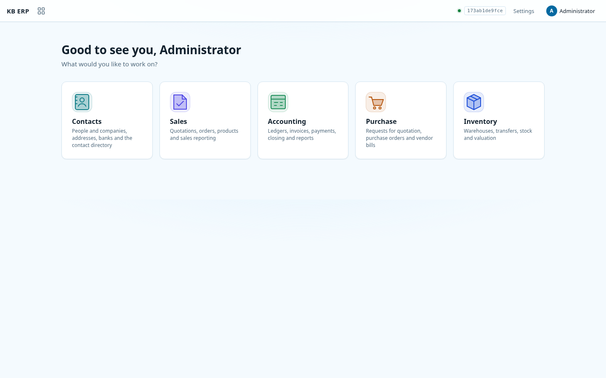
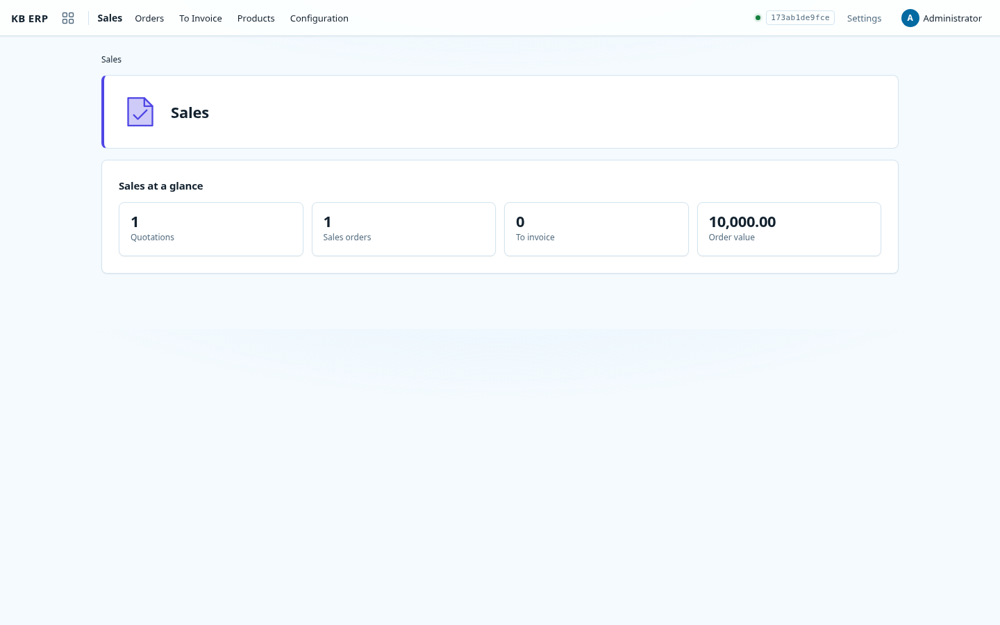
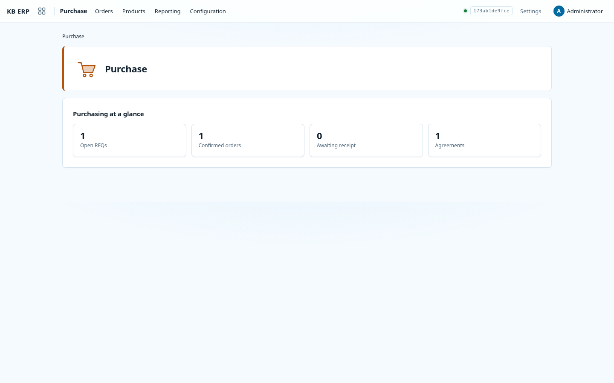
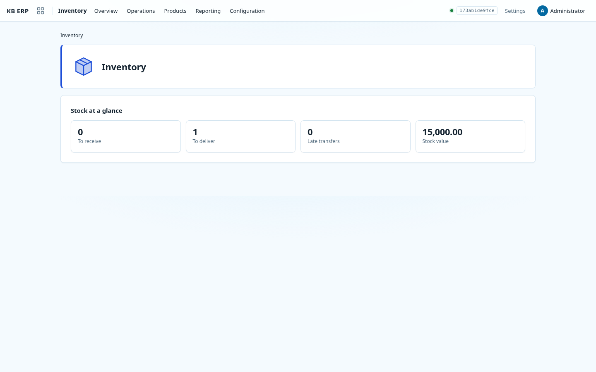
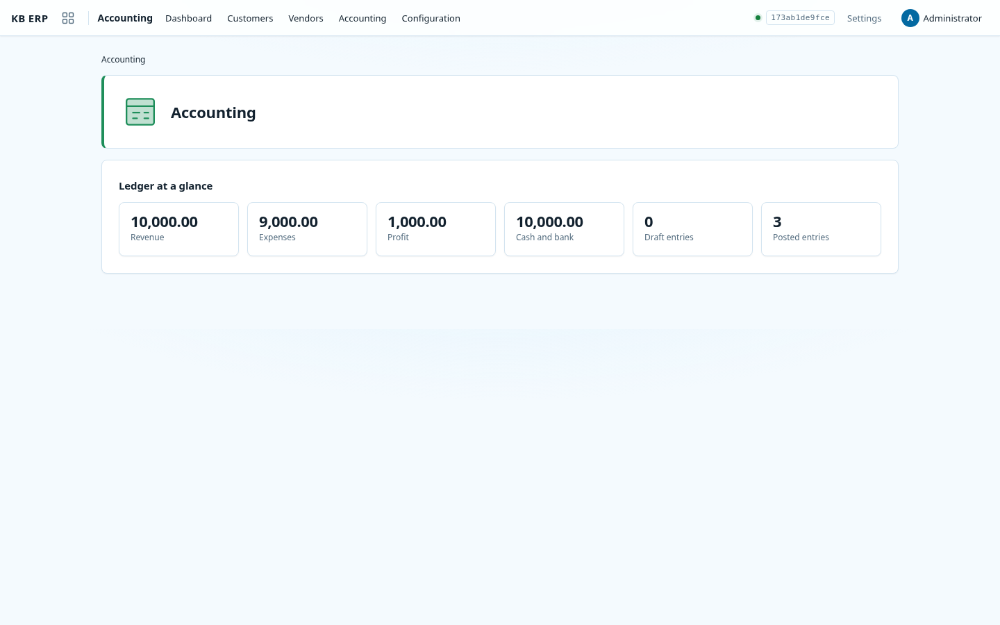

# Five-minute demo

`make demo` builds the containers, starts PostgreSQL, Redis, the web server and
the worker, installs the reference data and loads a deterministic set of
business documents. You do not need a local Python or Node environment.

## Start it

```bash
make demo
```

Open <http://localhost:8069> and sign in as `admin` / `admin`.

The first run builds the image and can take a minute. Later runs reuse the
database; the demo seed checks its marker document and does not duplicate
anything.

To start from a clean database:

```bash
make demo-reset   # removes the Compose volumes first
```

## What is in the database

`make demo` runs `kberp init --with-demo` and then `kberp demo`. Together they
install:

| Area | Records |
|---|---|
| Contacts | Apex Logistics Ltd (company, Nairobi), its delivery address and operations manager, Acme Trading (Mombasa) |
| Products | Warehouse Pallet (`PLT-001`), Logistics Service (`SRV-001`), Packing Tape (`TAPE-001`) |
| Sales | One draft quotation, one confirmed sale for four pallets, a posted invoice and a full customer payment |
| Purchase | One draft RFQ for a logistics service, one confirmed order for ten pallets, a completed receipt and a posted vendor bill |
| Inventory | Ten pallets received into stock and an outgoing delivery reserved for the confirmed sale |
| Accounting | Chart of accounts, journals, taxes, an equipment asset, the paid receivable and the open payable |

The seed is idempotent. The confirmed sale carries `reference = DEMO-SO-001`;
if it already exists, `kberp demo` returns without writing.

## Tour

1. **Launcher** — all five apps and the live counts. The source build stamp is
   in the top bar in debug mode.
2. **Contacts** — search for `Acme`, switch between list and kanban, and open
   the record. The smart buttons reach quotations, invoices and stock.
3. **Sales** — open the draft quotation, then the confirmed order. The invoice
   is paid and the delivery is reserved. Try *Create Invoice* on the confirmed
   order to see the guard against double invoicing.
4. **Purchase** — open the RFQ, then the confirmed order. The receipt is done
   and the bill is posted but unpaid, so payables show a balance.
5. **Inventory** — the receipt put ten pallets in stock. Open *Stock on Hand*
   and the move history for the pallet.
6. **Accounting** — open the customer invoice and its payment, then the vendor
   bill. The trial balance and P&L reconcile with the posted documents.

## Screenshots

| Launcher | Sales |
|---|---|
|  |  |

| Purchase | Inventory | Accounting |
|---|---|---|
|  |  |  |

Refresh them against a running demo with:

```bash
cd client && npm run screenshots
```

## Useful commands

```bash
make smoke          # 21 browser checks: sign in, apps, contact, quote to cash, invoice
make smoke-all      # every top-bar menu and page-header control as well
make logs           # follow the web container
make down           # stop the stack, keep the database
make demo-reset     # stop, delete the volumes and rebuild from scratch
```

If the top bar shows a different build stamp from `make build-id`, the browser
is talking to a stale container. Run `make demo` again and hard-refresh.

## Troubleshooting

- **Port 8069 or 5433 already in use** — stop the other stack with
  `docker compose down`, or change the published port in `docker-compose.yml`.
- **`/readyz` is not ready** — wait a few seconds and retry; the web container
  waits for PostgreSQL and Redis health checks before it starts.
- **Demo data is missing** — `make demo` runs the seed only when the marker is
  absent. Use `make demo-reset` if you need a clean rebuild.
