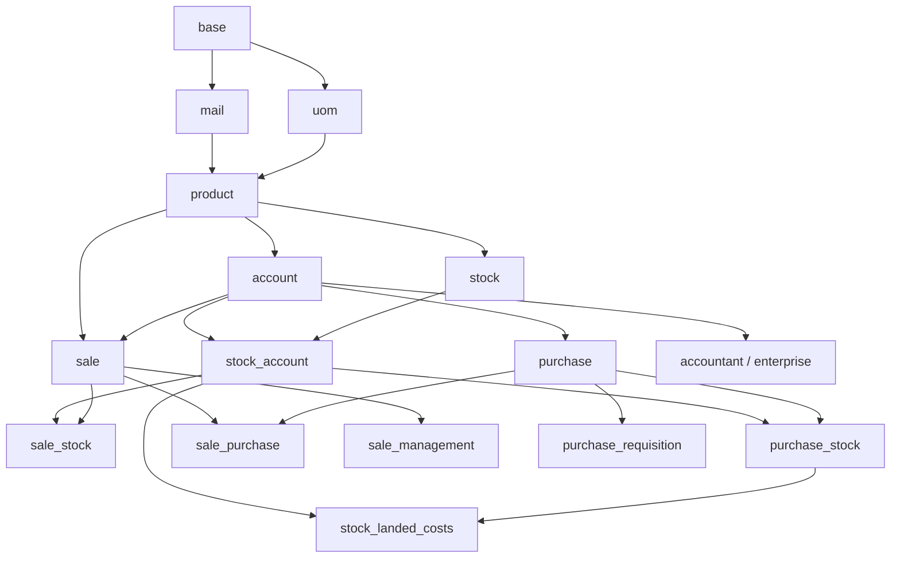
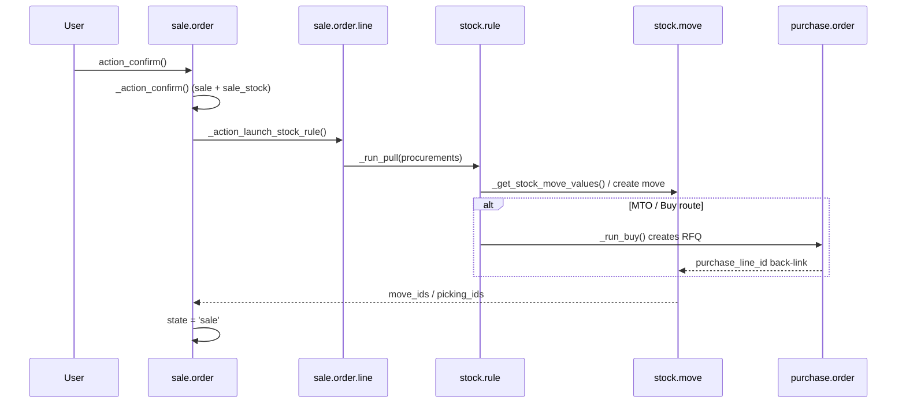
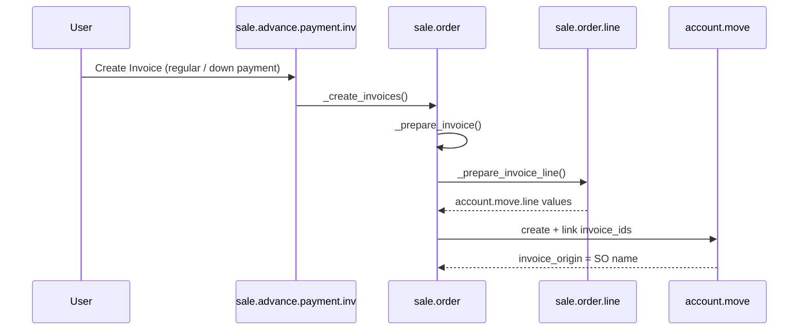
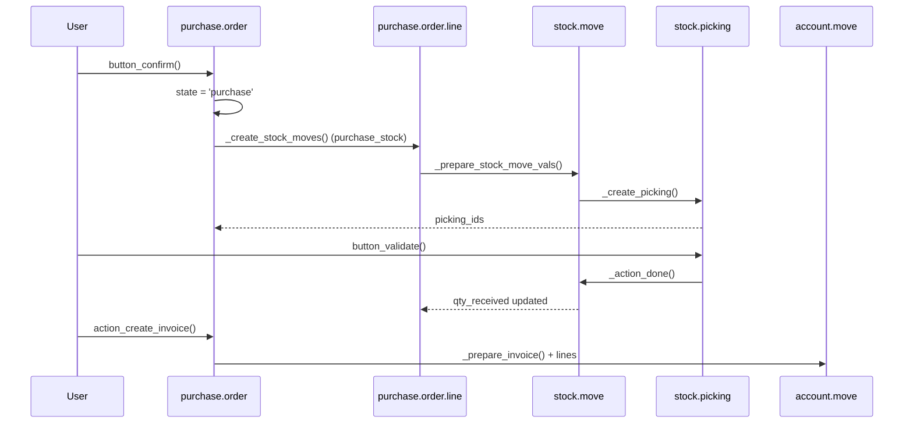
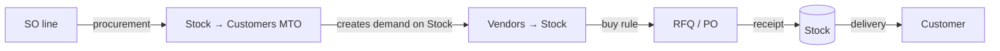
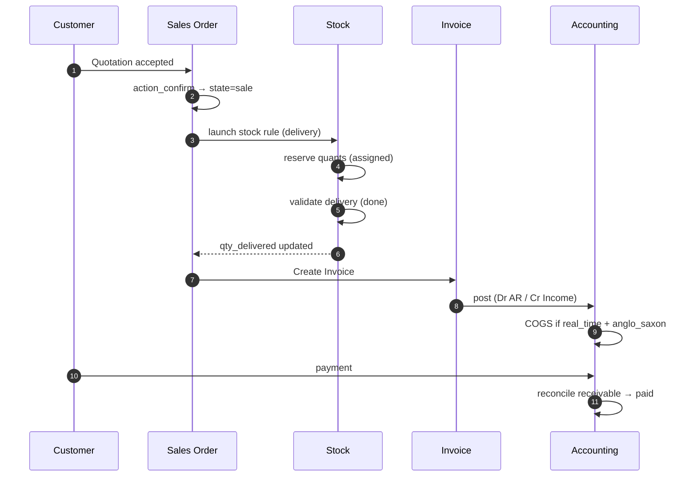
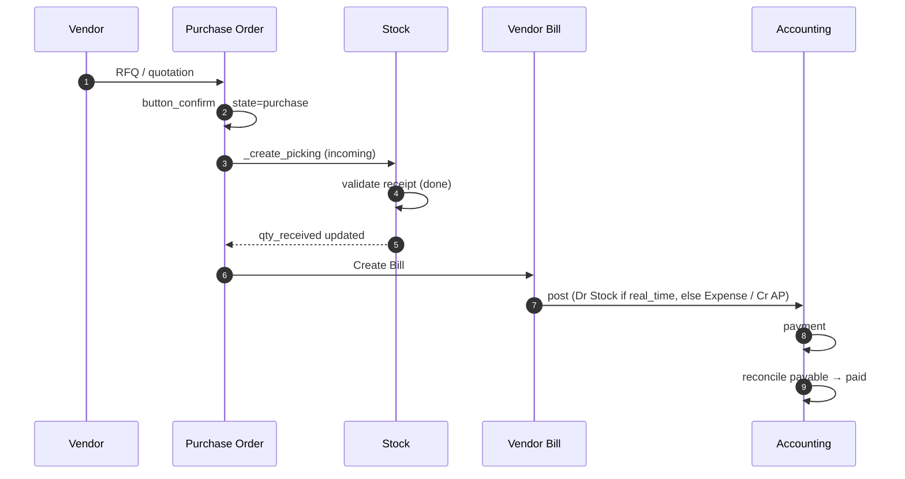

# Odoo 19 — Sales, Purchase, Inventory & Accounting

**Module architecture, code interconnections and UI navigation**

> Snapshot taken from the running installation at <http://localhost:8091/>.
> Odoo server version: **19.0-20260619**.
> Database inspected: **newdb** (same installed module set as `neeew`).
> Company: **My Company**, chart template **`ke`** (Kenya), currency **KES**.

**Contents**

0. [How this document was produced](#0-how-this-document-was-produced)
1. [Installed modules in scope](#1-installed-modules-in-scope)
2. [Source map](#2-source-map--where-the-behaviour-lives)
3. [Dependency graph](#3-dependency-graph)
4. [Shared master data](#4-shared-master-data)
5. [Sales](#5-sales-sale-sale_management-sale_stock)
6. [Purchase](#6-purchase-purchase-purchase_stock-purchase_requisition)
7. [Inventory](#7-inventory-stock-stock_account)
8. [Accounting](#8-accounting-account-stock_account)
9. [Interconnections](#9-interconnections)
10. [UI navigation](#10-ui-navigation-from-live-newdb-menus)
11. [This installation's configuration](#11-this-installations-configuration)
12. [Security model](#12-security-model-groups-that-gate-the-ui)
13. [Extension points](#13-extension-points-where-to-hook-custom-behaviour)
14. [Verification queries](#14-verification-queries)
15. [Glossary](#15-glossary)
16. [Summary](#16-summary--the-mental-model)

---

## 0. How this document was produced

| Item | Value |
|---|---|
| Odoo container | `kbmart_odoo_platform` |
| PostgreSQL container | `kbmart_postgres_database` |
| UI URL | <http://localhost:8091/> |
| Core addons in container | `/usr/lib/python3/dist-packages/odoo/addons/` |
| Enterprise addons in container | `/mnt/enterprise-addons` (`/opt/kbmart_odoo_platform/addons/enterprise/`) |
| Custom addons in container | `/mnt/custom-addons` (`/home/brian/odoo-dev/kbmart/custom_addons`) |
| Host copy used for reading | `/tmp/opencode/odoo19src` (temporary analysis copy) |
| Generated model inventory | `/tmp/opencode/model_inventory.json` (temporary) |

> The `/tmp/opencode` paths were temporary analysis artifacts. The authoritative
> sources remain in the container image and can be re-copied with `docker cp`
> when the `kbmart_odoo_platform` container is running.

All file/line references below are relative to a module root, e.g.
`purchase/models/purchase_order.py:625`. For the host copy, prefix with
`/tmp/opencode/odoo19src/`.

The documentation is based on **source code reading** (not just UI observation), plus
live queries against `newdb` for menus, settings, journals, accounts and warehouse
configuration.

---

## 1. Installed modules in scope

| Module | Version | Role |
|---|---|---|
| `product` | 19.0.1.2 | Product templates/variants, UoM, categories, pricelists base |
| `account` | 19.0.1.4 | Journal entries, invoices, payments, taxes, reconciliation |
| `sale` | 19.0.1.2 | Quotations, sales orders, sales invoicing |
| `sale_management` | 19.0.1.0 | Quotation templates, sales app menus, optional products |
| `sale_stock` | 19.0.1.0 | SO → delivery, stock smart buttons, delivered-qty invoicing |
| `sale_purchase` | 19.0.1.0 | SO ↔ PO cross-links (subcontracting/MTO purchases) |
| `purchase` | 19.0.1.2 | RFQ, purchase orders, vendor bills, approvals |
| `purchase_stock` | 19.0.1.2 | PO → receipt, buy route, receipt status |
| `purchase_requisition` | 19.0.0.1 | Purchase agreements / blanket orders |
| `stock` | 19.0.1.1 | Transfers, moves, rules, routes, warehouses, quants |
| `stock_account` | 19.0.1.1 | Stock valuation and accounting integration |
| `accountant` | 19.0.1.1 | Enterprise Accounting app (reparents Invoicing menus) |
| `l10n_ke` | 19.0.1.0 | Kenya chart of accounts and taxes |
| `insurance_broker_finance` | 19.0.1.0.0 | Custom: premium administration, commission settlement |
| `insurance_broker_claims` | 19.0.2.0.0 | Custom: FNOL, claims, SLA, loss-ratio analytics |
| `mobipine_odoo_tumizi_extension` | 19.0.2.0.0 | Custom: Tumizi payouts (M-Pesa/bank) |

`stock_landed_costs` is available in the source tree but **not installed** in this
database. Its architecture is still described in §7.9 because it is part of the
standard inventory/accounting surface.

---

## 2. Source map — where the behaviour lives

### 2.1 Sales

| File | Contents |
|---|---|
| `sale/models/sale_order.py` | `sale.order`: state, totals, confirmation, invoicing |
| `sale/models/sale_order_line.py` | `sale.order.line`: pricing, taxes, qty delivered/invoiced |
| `sale/models/account_move.py` | Invoice ↔ SO links, down-payment handling |
| `sale/models/account_move_line.py` | `sale_line_ids` M2M on invoice lines |
| `sale/models/product_template.py` | `invoice_policy` |
| `sale/wizard/sale_make_invoice_advance.py` | Advance/down-payment invoice wizard |
| `sale_management/` | Quotation templates, optional products, app menus |
| `sale_stock/models/sale_order.py` | Delivery smart button, effective date, invoice prep |
| `sale_stock/models/sale_order_line.py` | Procurement values, `_action_launch_stock_rule` |
| `sale_stock/models/stock.py` | `stock.move.sale_line_id`, `stock.picking.sale_id` |
| `sale_purchase/models/` | SO line ↔ PO line creation/linking |

### 2.2 Purchase

| File | Contents |
|---|---|
| `purchase/models/purchase_order.py` | `purchase.order`: state, approval, billing |
| `purchase/models/purchase_order_line.py` | `purchase.order.line`: qty received/billed, pricing |
| `purchase/models/account_invoice.py` | Bill ↔ PO links, bill matching |
| `purchase/models/purchase_bill_line_match.py` | "Bill Matching" wizard logic |
| `purchase_stock/models/purchase_order.py` | Receipt status, picking creation, smart button |
| `purchase_stock/models/purchase_order_line.py` | Stock move preparation/creation |
| `purchase_stock/models/stock_rule.py` | `_run_buy` (buy route) |
| `purchase_stock/models/stock.py` | `stock.picking.purchase_id`, `stock.warehouse.buy_pull_id` |
| `purchase_requisition/models/` | Blanket orders / purchase agreements |

### 2.3 Inventory

| File | Contents |
|---|---|
| `stock/models/stock_move.py` | Atomic stock movement, reservation, done |
| `stock/models/stock_picking.py` | Transfer document, validation, backorders |
| `stock/models/stock_rule.py` | Pull/push procurement rules |
| `stock/models/stock_route.py` | Routes composed of rules |
| `stock/models/stock_warehouse.py` | Warehouse, operation types, resupply |
| `stock/models/stock_location.py` | Location hierarchy and usage types |
| `stock/models/stock_quant.py` | On-hand quantities per location/lot/owner |
| `stock/models/stock_move_line.py` | Detailed move lines (lot, package, owner) |
| `stock/models/stock_lot.py` | Lots / serial numbers |
| `stock/models/stock_orderpoint.py` | Reordering rules / replenishment |
| `stock/models/stock_scrap.py` | Scrap operations |

### 2.4 Accounting

| File | Contents |
|---|---|
| `account/models/account_move.py` | Journal entries and invoices, posting, payments |
| `account/models/account_move_line.py` | Journal items, reconciliation |
| `account/models/account_journal.py` | Journals and sequences |
| `account/models/account_account.py` | Accounts and account types |
| `account/models/account_payment.py` | Payments and payment register |
| `account/models/product.py` | Product → account resolution (`_get_product_accounts`) |
| `stock_account/models/stock_move.py` | Stock move valuation, valuation journal entries |
| `stock_account/models/account_move.py` | COGS lines on customer invoices |
| `stock_account/models/res_company.py` | Periodic stock closing entries |
| `stock_account/models/product.py` | Category valuation/account fields |
| `stock_account/models/stock_location.py` | Location valuation accounts |

### 2.5 Bridge modules

| Module | Overrides / adds |
|---|---|
| `sale_stock` | `sale.order._action_confirm`, `action_view_delivery`; `stock.move.sale_line_id`; `stock.picking.sale_id`; delivered-qty invoice computation |
| `purchase_stock` | `purchase.order._create_picking`, `action_view_picking`, `_compute_receipt_status`; `_run_buy`; `stock.picking.purchase_id` |
| `sale_purchase` | Propagates SO line into generated PO line; `sale_line_id` on `purchase.order.line` |
| `stock_account` | Valuation on `stock.move._action_done`; COGS on `account.move._post`; closing entries |

---

## 3. Dependency graph



**Layering rule of thumb**

1. `product` defines *what* is bought/sold/stored.
2. `account` defines *how value is booked*.
3. `stock` defines *where and when goods move*.
4. `sale` and `purchase` define *commercial documents*.
5. `sale_stock` / `purchase_stock` bind commercial documents to physical moves.
6. `stock_account` binds physical moves to accounting value.

This is why no bridge module contains a full workflow of its own: each one only
overrides a hook (`_action_confirm`, `_create_picking`, `_action_done`, `_post`).

---

## 4. Shared master data

### 4.1 Product model (Odoo 19 changes)

Odoo 19 keeps `product.template` / `product.product` but changed the type model:

```python
# product/models/product_template.py:54
type = fields.Selection(
    selection=[('consu', "Goods"), ('service', "Service"), ('combo', "Combo")],
    default='consu', required=True,
)
```

There is **no `product` type** any more. Physical inventory is controlled by the
boolean `is_storable` (defined on `product.template` at
`stock/models/product.py:821`, and available on `product.product` through
delegation inheritance):

- `type = 'consu'` + `is_storable = True` → stocked goods (what used to be "Product").
- `type = 'consu'` + `is_storable = False` → non-stored goods (consumables).
- `type = 'service'` → never stocked.
- `type = 'combo'` → sales-only bundle.

Key commercial fields:

| Field | Model | Meaning |
|---|---|---|
| `invoice_policy` | `product.template` | `order` = invoice ordered qty; `delivery` = invoice delivered qty (`sale/models/product_template.py:35`) |
| `purchase_method` | `product.template` | `purchase` = bill ordered qty; `receive` = bill received qty (`purchase/models/product.py:14`) |
| `standard_price` | `product.product` | Cost used by standard-cost valuation |
| `categ_id` | `product.template` | Product category, carries valuation and accounts |
| `uom_id` / `uom_po_id` | `product.template` | Sales / purchase units of measure |
| `taxes_id` / `supplier_taxes_id` | `product.template` | Default customer / vendor taxes |
| `property_account_income_id` / `property_account_expense_id` | `product.template` | Account overrides at product level |
| `route_ids` | `product.template` | Routes such as Buy, Manufacture, Dropship |

### 4.2 Product categories and valuation

Valuation is configured on `product.category`, not on the product:

| Field | Purpose |
|---|---|
| `property_cost_method` | `standard`, `fifo`, `average` |
| `property_valuation` | `periodic` (at closing) or `real_time` (at invoicing); when empty, falls back to `res.company.inventory_valuation` |
| `property_stock_valuation_account_id` | Balance-sheet stock account |
| `property_stock_journal` | Journal for valuation entries |
| `property_price_difference_account_id` | Price-difference account (standard cost) |

> **Odoo 19 change:** the old category fields
> `property_stock_account_input_categ_id` and
> `property_stock_account_output_categ_id` no longer exist. Perpetual
> valuation is now booked **at invoicing** against the stock valuation account,
> not through stock input/output interim accounts. The accounts `100110` and
> `100120` still exist in the Kenyan chart but are not wired by default.

In this database all categories have `property_cost_method = standard` and an
**empty** `property_valuation`, which means the Odoo default:
**periodic valuation at closing**. See §8.7 and §11.

### 4.3 Partner

Commercial links live on `res.partner`:

- `property_account_receivable_id` / `property_account_payable_id`
- `property_account_position_id` (fiscal position)
- `property_payment_term_id` / `property_supplier_payment_term_id`
- `property_stock_customer` / `property_stock_supplier` (virtual locations)
- `sale_warn_msg`, `purchase_warn_msg` (warning groups)
- `supplier_rank` / `customer_rank` (drive "Vendors"/"Customers" menus)

The partner model itself — company/person hierarchy, address types, commercial-field
synchronisation, tags, banks, countries and the Contacts app — is documented in the
companion file [`odoo-contacts-module.md`](odoo-contacts-module.md).

---

## 5. Sales (`sale`, `sale_management`, `sale_stock`)

### 5.1 Core models

| Model | File | Purpose |
|---|---|---|
| `sale.order` | `sale/models/sale_order.py` | Quotation / sales order header |
| `sale.order.line` | `sale/models/sale_order_line.py` | Product lines, pricing, invoiced/delivered qty |
| `sale.advance.payment.inv` | `sale/wizard/sale_make_invoice_advance.py` | Down-payment / advance invoice wizard |
| `sale.order.template` | `sale_management/models/sale_order_template.py` | Quotation templates |
| `crm.team` | `sales_team` + `sale/models/crm_team.py` | Sales teams, invoicing targets |

### 5.2 Sales order state machine

Defined in `sale/models/sale_order.py:26`:

| From | Action | To |
|---|---|---|
| `draft` | `action_quotation_send` / email | `sent` |
| `draft`, `sent` | `action_confirm` | `sale` |
| `draft`, `sent`, `sale` | `action_cancel` | `cancel` |
| `sale` (when allowed) | `action_draft` | `draft` |

```text
draft ──action_quotation_send──▶ sent
  │                                │
  └──────────action_confirm────────┴──▶ sale
                                          │
                                          │ action_cancel
                                          ▼
                                        cancel
```

| State | UI label | Meaning |
|---|---|---|
| `draft` | Quotation | Editable, not committed |
| `sent` | Quotation Sent | Sent to customer, still editable |
| `sale` | Sales Order | Confirmed; procurement and invoicing unlocked |
| `cancel` | Cancelled | Cancelled; linked pickings may be cancelled |

`locked` is a separate boolean (`sale/models/sale_order.py:77`). A locked order is
still in state `sale` but is read-only. The "Lock Confirmed Sales" setting
(`sale.group_auto_done_setting`) locks automatically.

`invoice_status` is computed (`sale/models/sale_order.py:245`, compute at `:619`):

| Value | UI label | Condition |
|---|---|---|
| `no` | Nothing to Invoice | Not confirmed, or nothing invoiceable |
| `to invoice` | To Invoice | At least one line can be invoiced |
| `invoiced` | Fully Invoiced | All lines invoiced |
| `upselling` | Upselling Opportunity | All lines invoiced/upselling, qty increased after invoice |

### 5.3 Confirmation flow



Key methods:

| Method | File:line | What it does |
|---|---|---|
| `action_confirm` | `sale/models/sale_order.py:1166` | Public button; validates and calls `_action_confirm` |
| `_action_confirm` | `sale/models/sale_order.py:1231` | Core confirmation; sets state, triggers procurement |
| `_action_confirm` (override) | `sale_stock/models/sale_order.py:213` | Launches stock rules, sets effective date |
| `_action_launch_stock_rule` | `sale_stock/models/sale_order_line.py:375` | Builds procurements per line and runs rules |
| `_prepare_procurement_values` | `sale_stock/models/sale_order_line.py:278` | Passes date, warehouse, route, SO link into moves |

`sale_stock` also writes `stock.move.sale_line_id` and computes
`stock.picking.sale_id`, which is what makes the smart buttons work
(`sale_stock/models/stock.py:17` and `:186`).

### 5.4 Pricing and totals

- Pricelists: `product.pricelist` / `product.pricelist.item`; resolved on
  `sale.order.line._compute_price_unit`.
- Discounts: `discount` field; visible with `sale.group_discount_per_so_line`.
- Taxes: `tax_ids` on the line; totals computed by `account.tax.compute_all`.
- `amount_untaxed`, `amount_tax`, `amount_total` are stored computed fields
  (`sale/models/sale_order.py:232-234`).

### 5.5 Invoicing

#### Invoice policy

`product.template.invoice_policy` (`sale/models/product_template.py:35`):

- **Ordered quantities** (`order`): invoice as soon as the SO is confirmed.
- **Delivered quantities** (`delivery`): invoice only what has been delivered.

The base line compute uses `qty_delivered` when the policy is `delivery`
(`sale/models/sale_order_line.py:1045`); `sale_stock` supplies `qty_delivered`
from done moves and refines the invoice status for partially delivered lines
(`sale_stock/models/sale_order_line.py:216`).

#### Invoice creation

The normal UI path is:

```
Sales → Orders → Orders → [order] → Create Invoice
```

which opens the **`sale.advance.payment.inv`** wizard and then calls
`sale.order._create_invoices` (`sale/models/sale_order.py:1550`).



| Method | File:line | Purpose |
|---|---|---|
| `_prepare_invoice` | `sale/models/sale_order.py:1411` | Header values: partner, currency, payment term, origin, journal |
| `_prepare_invoice` (override) | `sale_stock/models/sale_order.py:298` | Adds incoterm and delivery date |
| `_prepare_invoice_line` | `sale/models/sale_order_line.py:1499` | Line values incl. `sale_line_ids`, taxes, discount |
| `_create_invoices` | `sale/models/sale_order.py:1550` | Groups lines, creates `account.move` |
| `action_view_invoice` | `sale/models/sale_order.py:1453` | Smart button action |

Important invoice header fields set from the SO:

- `move_type = 'out_invoice'`
- `invoice_origin = sale.order.name`
- `ref = client_order_ref or name`
- `partner_id = partner_invoice_id`
- `invoice_payment_term_id`, `fiscal_position_id`, `journal_id`
- `team_id`, `user_id`, campaign/medium/source (UTM)
- `transaction_ids` (online payments)

Invoice lines carry:

- `product_id`, `quantity = qty_to_invoice`
- `price_unit`, `discount`, `tax_ids`
- `sale_line_ids` (M2M to `sale.order.line`, defined in
  `sale/models/account_move_line.py:12`)
- `is_downpayment` for advance lines

#### Down payments

Down payments are invoice lines flagged `is_downpayment`, generated by the wizard.
The wizard's `deduct_down_payments` option (default `True`) is passed to
`_create_invoices(final=...)`; down-payment lines are tracked through
`is_downpayment` and the SO line's invoice lines
(`sale/models/account_move.py` and `sale/models/sale_order_line.py`).
The SO's `prepayment_percent` and `require_payment` fields support online
prepayment before confirmation.

### 5.6 Sales smart buttons and actions

| Button | Field / action | Source |
|---|---|---|
| Delivery | `action_view_delivery` | `sale_stock/models/sale_order.py:249` |
| Invoices | `action_view_invoice` | `sale/models/sale_order.py:1453` |
| Sales Order (on invoice) | `action_view_source_sale_orders` | `sale/models/account_move.py:151` |
| Upsell | `action_view_upsell` / `upselling` status | `sale` |

### 5.7 Cancellation

`action_cancel` (`sale/models/sale_order.py:1324`) cancels the SO and propagates
cancellation to linked procurements/moves where `propagate_cancel` is set.
`_action_cancel` in `sale_stock` cancels pickings that are not yet done.

Confirmed orders can be reset to quotation only while not locked and while no
posted invoice/done delivery blocks it. Odoo enforces this through
`_can_be_reset_to_draft` style checks in `sale` and `stock`.

---

## 6. Purchase (`purchase`, `purchase_stock`, `purchase_requisition`)

### 6.1 Core models

| Model | File | Purpose |
|---|---|---|
| `purchase.order` | `purchase/models/purchase_order.py` | RFQ / purchase order |
| `purchase.order.line` | `purchase/models/purchase_order_line.py` | Product lines, received/billed qty |
| `purchase.requisition` | `purchase_requisition/models/purchase_requisition.py` | Blanket order / agreement |
| `purchase.bill.line.match` | `purchase/models/purchase_bill_line_match.py` | Bill matching helper |

### 6.2 Purchase state machine

Defined in `purchase/models/purchase_order.py:105`:

| State | UI label | Meaning |
|---|---|---|
| `draft` | RFQ | Draft request for quotation |
| `sent` | RFQ Sent | Sent to vendor |
| `to approve` | To Approve | Waiting for manager approval (if `purchase.group_purchase_manager` and double validation) |
| `purchase` | Purchase Order | Confirmed; receipts and bills unlocked |
| `cancel` | Cancelled | Cancelled |

```text
draft ──send──▶ sent ──confirm──▶ [to approve] ──approve──▶ purchase
  │                │                    │                      │
  └────────────────┴────────────────────┴──── button_cancel ──▶ cancel
```

`locked` (`purchase/models/purchase_order.py:112`) makes a confirmed PO read-only.
Company field `po_lock` controls automatic locking.

`receipt_status` is added by `purchase_stock`
(`purchase_stock/models/purchase_order.py:39`, compute at `:69`):

| Value | UI label |
|---|---|
| `pending` | Not Received |
| `partial` | Partially Received |
| `full` | Fully Received |

`invoice_status` is analogous to sales:

| Value | UI label |
|---|---|
| `no` | Nothing to Bill |
| `to invoice` | Waiting Bills |
| `invoiced` | Fully Billed |

### 6.3 Confirmation and receipt flow



Key methods:

| Method | File:line | Purpose |
|---|---|---|
| `button_confirm` | `purchase/models/purchase_order.py:625` | Confirm RFQ / PO |
| `button_approve` | `purchase/models/purchase_order.py:615` | Manager approval |
| `_create_picking` | `purchase_stock/models/purchase_order.py:375` | Create receipt(s) |
| `_prepare_picking` | `purchase_stock/models/purchase_order.py:358` | Picking header values |
| `_prepare_stock_moves` | `purchase_stock/models/purchase_order_line.py:206` | Build moves per line |
| `_prepare_stock_move_vals` | `purchase_stock/models/purchase_order_line.py:283` | Move values incl. `purchase_line_id` |
| `_create_stock_moves` | `purchase_stock/models/purchase_order_line.py:364` | Persist moves, confirm them |
| `action_view_picking` | `purchase_stock/models/purchase_order.py:235` | Receipt smart button |
| `action_create_invoice` | `purchase/models/purchase_order.py:760` | Create vendor bill |
| `_prepare_invoice` | `purchase/models/purchase_order.py:925` | Bill header values |
| `action_view_invoice` | `purchase/models/purchase_order.py:948` | Vendor bills smart button |

### 6.4 Receipt creation details

`purchase_stock` creates one picking per PO and per destination/operation type.
The move values include (`purchase_stock/models/purchase_order_line.py:283`):

```python
{
    'product_id': ...,
    'location_id': partner.property_stock_supplier.id,
    'location_dest_id': picking_type.default_location_dest_id.id,
    'picking_id': picking.id,
    'purchase_line_id': self.id,
    'price_unit': price_unit,
    'product_uom_qty': product_uom_qty,
    'origin': order.name,
    'propagate_cancel': ...,
}
```

The source location is the vendor virtual location
(`suppliers` usage). The destination is the warehouse's input location (or Stock
in a one-step warehouse).

`stock.move.purchase_line_id` is defined in `purchase_stock/models/stock_move.py:15`,
and `stock.picking.purchase_id` is a related field through
`move_ids.purchase_line_id.order_id` (`purchase_stock/models/stock.py:13`).

### 6.5 Billing / control policy

`product.template.purchase_method` (`purchase/models/product.py:14`):

- **On ordered quantities** (`purchase`): bill full ordered qty after confirmation.
- **On received quantities** (`receive`): bill only received qty (default for goods).

`purchase.order.line.qty_to_invoice` and `invoice_status` are computed from
`qty_received` / `qty_invoiced` accordingly.

Bill creation paths:

1. **PO → Create Bill** — `action_create_invoice`
   (`purchase/models/purchase_order.py:760`), then `_prepare_invoice` (`:925`) and
   `_prepare_account_move_line` on each line.
2. **Bill → Add PO lines / Bill Matching** — `purchase/models/account_invoice.py`
   (`_add_purchase_order_lines`, `purchase.bill.line.match`).
3. **Vendor bill uploaded with PO reference** — matching wizard links lines to
   `purchase.order.line`.

Bill lines carry `purchase_line_id`
(`purchase/models/account_invoice.py:528`). Bills show a **Purchases** smart button
(`purchase/models/account_invoice.py:158`).

### 6.6 Purchase agreements

`purchase_requisition` adds blanket orders:

- `purchase.requisition` (agreement header) with `date_start`, `date_end`,
  `requisition_type` (`blanket_order` / `purchase_template`).
- PO lines can be generated from the agreement; `requisition_id` links back.

---

## 7. Inventory (`stock`, `stock_account`)

### 7.1 Vocabulary

| Concept | Model | Meaning |
|---|---|---|
| Warehouse | `stock.warehouse` | Physical site with operations and routes |
| Location | `stock.location` | Tree of places; `usage` = internal/supplier/customer/inventory/production/transit |
| Operation type | `stock.picking.type` | Receipts / Delivery / Internal / POS; controls numbering and behaviour |
| Transfer | `stock.picking` | Document grouping moves |
| Move | `stock.move` | Demand to move a product from A to B |
| Move line | `stock.move.line` | Actual detailed execution (lot, package, owner, qty) |
| Quant | `stock.quant` | On-hand quantity per location/lot/owner |
| Rule | `stock.rule` | Procurement logic (pull, push, buy, manufacture) |
| Route | `stock.route` | Named set of rules applied to a product/warehouse |
| Orderpoint | `stock.warehouse.orderpoint` | Min/max replenishment rule |

### 7.2 Stock move state machine

`stock/models/stock_move.py:107`:

| State | Meaning |
|---|---|
| `draft` | Created, not confirmed |
| `waiting` | Waiting for another move (MTO chain) |
| `confirmed` | Confirmed, not yet reserved |
| `partially_available` | Some quantity reserved |
| `assigned` | Fully reserved / ready |
| `done` | Executed |
| `cancel` | Cancelled |

```text
draft ─_action_confirm─▶ confirmed ─_action_assign─▶ assigned
                             │                         │
                             ├──▶ partially_available  │
                             │                         ▼
                             └──── _action_done ────▶ done
                                        │
                                        └──▶ cancel
```

Key methods:

| Method | File:line | Purpose |
|---|---|---|
| `_action_confirm` | `stock/models/stock_move.py:1557` | Merge/split moves, create procurement chain |
| `_action_assign` | `stock/models/stock_move.py:1912` | Reserve quants |
| `_action_done` | `stock/models/stock_move.py:2115` | Execute: update quants, lots, valuation |
| `_post_process_created_moves` | `stock/models/stock_move.py:2276` | Handle chained moves after done |

### 7.3 Stock picking

`stock/models/stock_picking.py:575` defines picking states:

| State | Meaning |
|---|---|
| `draft` | Draft transfer |
| `waiting` | Waiting availability / previous move |
| `confirmed` | Waiting (not yet ready) |
| `assigned` | Ready to process |
| `done` | Validated |
| `cancel` | Cancelled |

`button_validate` (`stock/models/stock_picking.py:1398`) runs checks (lots, quantities,
backorder choice) and calls `_action_done` (`:1255`).

Validation options:

- **No backorder**: remaining quantities are cancelled.
- **Create backorder**: remaining quantities stay in a new picking.
- **Skip checks** only for users with the relevant rights.

### 7.4 Rules, routes and procurement

A **pull rule** brings goods *into* a location when demand appears:

```python
# stock/models/stock_rule.py
_run_pull(procurements)            # :288
_get_stock_move_values(...)        # :324
```

A **buy rule** (`action = 'buy'`) delegates to `purchase_stock`:

```python
# purchase_stock/models/stock_rule.py
_run_buy(procurements)             # :59
```

A **push rule** moves goods onward after a move is done.

Procurement chain for an MTO sale:



Odoo links the moves with `move_orig_ids` / `move_dest_ids`. The upstream move
stays `waiting` until the downstream one is assigned.

### 7.5 Reservation and availability

- `_action_assign` reserves quants (FIFO by removal strategy on the location).
- `stock.quant` is the source of truth for on-hand.
- `free_qty = quantity - reserved_quantity`.
- The scheduler (`stock.rule._run_scheduler_tasks`, `stock/models/stock_rule.py:691`)
  creates procurements for orderpoints.
- `forecast_availability` on `stock.move` includes incoming/outgoing moves.

### 7.6 Lot/serial and packages

- `stock.lot` with `tracking` in `{'lot', 'serial'}` on the product.
- `stock.move.line` stores `lot_id`, `package_id`, `result_package_id`, `owner_id`.
- `stock.quant` is per `(product, location, lot, owner)`.
- Packages are `stock.package` / `stock.package.type`.

### 7.7 Adjustments and scrap

- **Physical inventory**: `stock.quant.action_apply_inventory` creates adjustment
  moves (`is_inventory = True`, `inventory_name`).
- **Scrap**: `stock.scrap` creates a move from internal to the scrap location
  (usage `inventory`), with `scrap_id` on the move.

### 7.8 This installation's warehouse

Live configuration in `newdb`:

| Setting | Value |
|---|---|
| Warehouse | `WH` — My Company |
| Reception steps | `one_step` |
| Delivery steps | `ship_only` |
| Operation types | Receipts (`IN`), Delivery Orders (`OUT`), Pick, Pack, Quality Control, Storage, Internal Transfers, Cross Dock, PoS Orders |
| Stock rules | `WH: Vendors → Stock`, `WH: Stock → Customers`, `WH: Stock → Customers (MTO)`, `WH: Stock (Buy)` |

Because delivery is `ship_only`, the normal customer flow is **Stock → Customers**
directly (no pick/pack). The extra internal operation types exist but are not part
of the default route.

### 7.9 Landed costs (source only, not installed here)

`stock_landed_costs` splits extra costs (freight, customs, insurance) across
incoming moves:

- `stock.landed.cost` header with `picking_ids`, `cost_lines`, `valuation_adjustment_lines`.
- `compute_landed_cost` distributes by weight/volume/equal/current cost.
- Posts a valuation adjustment on the related `stock.move` and an accounting entry
  in the stock journal.
- Requires `stock_account` and `purchase_stock`.

---

## 8. Accounting (`account`, `stock_account`)

### 8.1 Journal entry / invoice model

`account.move` covers both **journal entries** and **invoices**. `move_type`
(`account/models/account_move.py:142`) values:

| `move_type` | Document |
|---|---|
| `entry` | General journal entry |
| `out_invoice` | Customer invoice |
| `out_refund` | Customer credit note |
| `in_invoice` | Vendor bill |
| `in_refund` | Vendor credit note |
| `out_receipt` / `in_receipt` | POS receipts |

`state` (`account/models/account_move.py:129`): `draft`, `posted`, `cancel`.

`payment_state` (`account/models/account_move.py:600`): `not_paid`, `in_payment`,
`paid`, `partial`, `reversed`, `blocked`, `invoicing_legacy`.

### 8.2 Posting

`action_post` (`account/models/account_move.py:6098`) validates and calls `_post`
(`:5512`). Posting:

1. Assigns the journal entry number/sequence.
2. Checks balance (debit = credit).
3. Locks the move (`state = 'posted'`).
4. Runs `_post` overrides, including `stock_account` COGS generation.

`stock_account/models/account_move.py:29` overrides `_post`:

```python
def _post(self, soft=True):
    # create COGS lines for customer invoices (real-time valuation only)
    self.env['account.move.line'].create(
        self._stock_account_prepare_realtime_out_lines_vals())
    res = super()._post(soft)
    self.line_ids._get_stock_moves().filtered(
        lambda m: m.is_in or m.is_dropship)._set_value()
    return res
```

`button_draft` (`stock_account/models/account_move.py:46`) removes generated COGS
lines; `button_cancel` does the same defensively.

### 8.3 Journals in this database

| Code | Type | Name |
|---|---|---|
| `INV` | sale | Sales |
| `BILL` | purchase | Purchases |
| `MISC` | general | Miscellaneous Operations |
| `EXCH` | general | Exchange Difference |
| `CABA` | general | Cash Basis Taxes |
| `BNK1` | bank | Bank |
| `TAX` | general | Tax Returns |
| `STJ` | general | Inventory Valuation |
| `SLR` | general | Salaries |

### 8.4 Payments

- `action_register_payment` (`account/models/account_move.py:6019`) opens the payment
  register wizard.
- Payment creates an `account.payment` and reconciles the receivable/payable line.
- Partial payments set `payment_state = 'partial'`.
- Payments can be grouped per partner/currency; `account.payment.register` computes
  the amount due and withholding.

### 8.5 Taxes

`account.tax` supports:

- Percentage / fixed / division taxes.
- Price-included taxes (`price_include`).
- Withholding taxes — the dedicated `is_withholding_tax_on_payment` field comes
  from `l10n_account_withholding_tax` (not installed here), while `l10n_ke`
  supplies the rates.
- Tax groups, fiscal positions, and cash-basis taxes (`CABA` journal).

Kenya localization (`l10n_ke`) supplies VAT 16%, 8%, 0%, 0% exempt, and a set of
withholding rates (2%–30%). Taxes appear on invoice lines via `tax_ids`, and the
tax base/amount are stored on `account.move.line` (`tax_base_amount`,
`tax_line_id`, `tax_ids`).

### 8.6 How a product finds its accounts

`account/models/product.py:68` defines the base resolution; `stock_account`
extends it at `stock_account/models/product.py:127`.

Resolution order (simplified):

1. Product-level `property_account_income_id` / `property_account_expense_id`.
2. Product category accounts (`property_account_income_categ_id` /
   `property_account_expense_categ_id`), walking up the category hierarchy.
3. Company default accounts from the chart template
   (`income_account_id` / `expense_account_id`).

The base dict contains only:

```python
{'income': ..., 'expense': ...}
```

`stock_account` adds the stock keys:

```python
{
  'income': ...,
  'expense': ...,
  'stock_valuation': ...,   # category property_stock_valuation_account_id
                            # or company.account_stock_valuation_id
  'stock_variation': ...,   # stock_valuation.account_stock_variation_id
}
```

`get_product_accounts(fiscal_pos=...)` additionally maps accounts through the
fiscal position and adds `stock_journal`.

`stock_account` also reads `account.account.account_stock_variation_id` on the
stock valuation account to decide where the periodic closing difference goes;
`account_stock_expense_id` is used by the continental real-time variation path.

> Odoo 19 no longer returns `stock_input` / `stock_output` from
> `_get_product_accounts`: the category-level interim account fields were
> removed.

### 8.7 Stock valuation — periodic vs real-time

This is the single most important accounting/inventory boundary.

Odoo 19 uses two valuation modes
(`stock_account/models/product.py:698`):

| Value | UI label | Entry timing |
|---|---|---|
| `periodic` | Periodic (at closing) | Manual/scheduled closing entry |
| `real_time` | Perpetual (at invoicing) | When the bill/invoice is posted |

The `product.product.valuation` field resolves the category value, falling back
to `res.company.inventory_valuation`
(`stock_account/models/product.py:73`):

```python
product_template.valuation = (
    product_template.categ_id.with_company(...).property_valuation
    or self.env.company.inventory_valuation
)
```

#### Move valuation is always computed

Independently of the accounting mode, every done move gets a `value`
(`stock_account/models/stock_move.py:_set_value`, `:284`). That value feeds:

- `product.product.total_value` / `avg_cost`
- the Inventory Valuation report
- the periodic closing calculation
- COGS computation on invoices

So "periodic" does **not** mean Odoo stops valuing stock; it only means Odoo
does not post a journal entry for every move.

#### Move-level journal entries (location valuation accounts)

`stock_account/models/stock_move.py:168` hooks `_action_done`:

```python
def _action_done(self, cancel_backorder=False):
    moves_out = self.filtered(lambda m: m._is_out())
    moves_out._set_value()
    moves = super()._action_done(...)
    moves_in = moves.filtered(lambda m: m.is_in or m.is_dropship)
    moves_in.with_context(...)._set_value()
    moves._create_account_move()
    ...
```

`_create_account_move` (`:184`) creates an `account.move` in
`company.account_stock_journal_id` when the move crosses a location that has a
`valuation_account_id` (`_get_account_move_line_vals`, `:220`):

| Case | Debit | Credit |
|---|---|---|
| Location with valuation account (incoming) | Stock valuation | Location valuation account |
| Location with valuation account (outgoing) | Location valuation account | Stock valuation |

`_should_create_account_move` (`:651`) requires all of:

- `product.is_storable`
- `move.is_valued`
- `location_dest_id.valuation_account_id` or `location_id.valuation_account_id`
- non-zero quantity
- `product.valuation == 'real_time'`

This path is for **location-specific valuation** (for example inter-company or
special valuation locations). Out of the box, customer/supplier/internal
locations have no `valuation_account_id`, so the normal flow does not post on
receipt/delivery.

#### Real-time at invoicing

This is the standard Odoo 19 perpetual flow:

1. **Vendor bill** — for a storable product with `valuation = 'real_time'`, the
   bill line's account is switched to `stock_valuation`
   (`stock_account/models/account_move_line.py:_compute_account_id`):

   ```
   Dr Stock (100100)          X
      Cr Accounts Payable     X
   ```

2. **Customer invoice** — `stock_account` adds COGS lines on posting
   (`stock_account/models/account_move.py:_stock_account_prepare_realtime_out_lines_vals`):

   ```
   Dr Cost of Sales (500100)  X
      Cr Stock (100100)       X
   ```

   plus the normal customer line:

   ```
   Dr Accounts Receivable     X
      Cr Income               X
   ```

3. **Stock moves** themselves do not post normal entries. Their `value` is still
   computed and is used as the source of the COGS amount.

`stock_account/models/account_move.py:29` overrides `_post`:

```python
def _post(self, soft=True):
    # create COGS lines for customer invoices (real-time valuation only)
    self.env['account.move.line'].create(
        self._stock_account_prepare_realtime_out_lines_vals())
    res = super()._post(soft)
    self.line_ids._get_stock_moves().filtered(
        lambda m: m.is_in or m.is_dropship)._set_value()
    return res
```

`button_draft` (`:46`) removes generated COGS lines; `button_cancel` does the
same defensively.

#### Periodic (this database)

In this database the company and all categories resolve to **`periodic`**.
Consequences:

- No journal entry is created on receipt/delivery.
- Vendor bills hit the expense account directly (no stock account switch).
- Customer invoices do not generate COGS lines.
- Stock value is corrected at period end by the **stock closing** process.
- The Inventory Valuation report shows the gap between physical value and the
  ledger before closing.

### 8.8 Periodic stock closing

`stock_account/models/res_company.py`:

| Method | Line | Purpose |
|---|---|---|
| `action_close_stock_valuation` | `:49` | User action; validates date/journal/account; creates closing entry |
| `_action_close_stock_valuation` | `:115` | Builds all adjustment AML values |
| `_cron_post_stock_valuation` | `:134` | Scheduled closing for companies with `inventory_period` daily/monthly and non-real-time valuation |
| `stock_value` | `:85` | Computes inventory value per valuation account from product `total_value` |
| `stock_accounting_value` | `:96` | Reads posted balances of valuation accounts |
| `_get_stock_valuation_account_vals` | `:232` | Difference inventory − accounting, booked to variation account |

The closing entry:

```
Dr Stock (100100)                X
   Cr Stock Variation (500105)   X
```

(Reversed if stock decreased.) The variation account comes from
`account.account.account_stock_variation_id` on `100100`, which in this DB points
to `500105`; the fallback is the company expense account.

The generated move has:

- `journal_id = company.account_stock_journal_id` (`STJ`)
- `ref = "Stock Closing"`
- `date = at_date or today`
- one debit/credit pair per valuation account

### 8.9 Anglo-Saxon COGS and this setup

`res_company.anglo_saxon_accounting = True` in this database. In Odoo 19 the
Anglo-Saxon COGS mechanism is tied to **real-time valuation at invoicing**:
`stock_account` generates COGS lines when a customer invoice is posted. With
periodic valuation, no COGS line is generated; the stock variation is recognised
through closing entries instead. Switching a category to `real_time` activates
the invoice-based COGS path without changing the sale or stock workflow.

### 8.10 Reconciliation

- `account.move.line.reconcile()` matches debit/credit lines on the same account.
- `account.partial.reconcile` stores partial matches.
- `account.full.reconcile` marks a group fully matched.
- Invoices become `paid` when their receivable/payable line is fully reconciled.

---

## 9. Interconnections

### 9.1 The link-field matrix

This is the backbone of cross-module traceability.

| From | Field | To | Defined in |
|---|---|---|---|
| `sale.order.line` | `move_ids` | `stock.move` | `sale_stock` |
| `stock.move` | `sale_line_id` | `sale.order.line` | `sale_stock/models/stock.py:17` |
| `stock.picking` | `sale_id` | `sale.order` | `sale_stock/models/stock.py:186` |
| `sale.order` | `picking_ids` | `stock.picking` | `sale_stock` |
| `stock.move` | `purchase_line_id` | `purchase.order.line` | `purchase_stock/models/stock_move.py:15` |
| `purchase.order` | `picking_ids` | `stock.picking` | `purchase_stock` |
| `stock.picking` | `purchase_id` | `purchase.order` | `purchase_stock/models/stock.py:13` |
| `account.move.line` | `sale_line_ids` | `sale.order.line` | `sale/models/account_move_line.py:12` |
| `account.move.line` | `purchase_line_id` | `purchase.order.line` | `purchase/models/account_invoice.py:528` |
| `account.move` | `stock_move_ids` | `stock.move` | `stock_account/models/account_move.py:8` |
| `stock.move` | `account_move_id` | `account.move` | `stock_account/models/stock_move.py:51` |
| `purchase.order.line` | `sale_line_id` | `sale.order.line` | `sale_purchase` |
| `stock.move` | `created_purchase_line_ids` | `purchase.order.line` | `purchase_stock/models/stock_move.py:18` |

### 9.2 Entity-relationship overview

```mermaid
erDiagram
  RES_PARTNER ||--o{ SALE_ORDER : customer
  RES_PARTNER ||--o{ PURCHASE_ORDER : vendor
  PRODUCT_TEMPLATE ||--o{ PRODUCT_PRODUCT : variant
  PRODUCT_TEMPLATE }o--|| PRODUCT_CATEGORY : categ
  SALE_ORDER ||--|{ SALE_ORDER_LINE : lines
  PURCHASE_ORDER ||--|{ PURCHASE_ORDER_LINE : lines
  SALE_ORDER_LINE ||--o{ STOCK_MOVE : sale_line_id
  PURCHASE_ORDER_LINE ||--o{ STOCK_MOVE : purchase_line_id
  STOCK_MOVE }o--|| STOCK_PICKING : picking
  STOCK_MOVE ||--o{ STOCK_MOVE_LINE : details
  STOCK_MOVE }o--|| STOCK_LOCATION : from
  STOCK_MOVE }o--|| STOCK_LOCATION : to
  STOCK_PICKING }o--|| STOCK_PICKING_TYPE : type
  SALE_ORDER ||--o{ ACCOUNT_MOVE : invoices
  PURCHASE_ORDER ||--o{ ACCOUNT_MOVE : bills
  ACCOUNT_MOVE ||--|{ ACCOUNT_MOVE_LINE : lines
  ACCOUNT_MOVE_LINE }o--o{ SALE_ORDER_LINE : sale_line_ids
  ACCOUNT_MOVE_LINE }o--|| PURCHASE_ORDER_LINE : purchase_line_id
  STOCK_MOVE }o--|| ACCOUNT_MOVE : valuation
  PRODUCT_PRODUCT }o--|| PRODUCT_CATEGORY : valuation
```

### 9.3 End-to-end sales chain



Document/field trail:

| Step | Document | Key evidence |
|---|---|---|
| Quote | `sale.order` (`draft`/`sent`) | `name` = `S00001` |
| Confirm | `sale.order` (`sale`) | `date_order`, `locked` |
| Deliver | `stock.picking` (outgoing) | `origin = SO name`, `sale_id` |
| Move | `stock.move` | `sale_line_id`, `state = done` |
| Invoice | `account.move` (`out_invoice`) | `invoice_origin = SO name`, `sale_line_ids` |
| Payment | `account.payment` | reconciled with invoice receivable |

### 9.4 End-to-end purchase chain



Document/field trail:

| Step | Document | Key evidence |
|---|---|---|
| RFQ | `purchase.order` (`draft`/`sent`) | `name` = `P00001` |
| Confirm | `purchase.order` (`purchase`) | `date_approve`, `locked` |
| Receive | `stock.picking` (incoming) | `origin = PO name`, `purchase_id` |
| Move | `stock.move` | `purchase_line_id`, `state = done` |
| Bill | `account.move` (`in_invoice`) | `invoice_origin = PO name`, `purchase_line_id` |
| Payment | `account.payment` | reconciled with bill payable |

### 9.5 MTO: one sale creates a purchase

With `Stock → Customers (MTO)` and `Stock (Buy)` rules:

1. SO confirmation creates a delivery move with `procure_method = 'make_to_order'`.
2. `_action_confirm` asks the source location's rule for supply.
3. The `Vendors → Stock` rule runs `_run_buy`
   (`purchase_stock/models/stock_rule.py:59`).
4. It groups demand by vendor/currency/company and creates an RFQ
   (`purchase.order`), with `purchase_line_id` on the buy move.
5. Receipt validation completes the upstream move; the delivery move becomes
   `assigned`.
6. `sale_purchase` keeps a direct SO line ↔ PO line reference for traceability.

`stock.move.created_purchase_line_ids` records the PO lines generated by a move
(`purchase_stock/models/stock_move.py:18`).

### 9.6 Smart-button map (UI traceability)

| On document | Button | Opens | Implementation |
|---|---|---|---|
| Sales Order | Delivery | Related pickings | `sale_stock/models/sale_order.py:249` |
| Sales Order | Invoices | Related invoices | `sale/models/sale_order.py:1453` |
| Purchase Order | Receipt | Related pickings | `purchase_stock/models/purchase_order.py:235` |
| Purchase Order | Vendor Bills | Related bills | `purchase/models/purchase_order.py:948` |
| Invoice (customer) | Sales Orders | Source SOs | `sale/models/account_move.py:151` |
| Bill (vendor) | Purchases | Source POs | `purchase/models/account_invoice.py:158` |
| Picking | Traceability | Upstream/downstream moves | `stock` |
| Picking | Moves / Operations | Move lines | `stock` |
| Product | On Hand / Forecast | Quants / forecast | `stock` |

### 9.7 Cancellation, returns and reversals

| Scenario | Mechanism |
|---|---|
| Cancel quotation | `sale.order.action_cancel`; nothing delivered/invoiced |
| Cancel confirmed SO | Cancels pending pickings; blocked if done moves exist |
| Cancel RFQ/PO | `purchase.order.button_cancel`; cancels pending receipts |
| Customer return | Reverse transfer (`stock.picking.return_id`) creates incoming move from customer; `to_refund` drives credit note |
| Vendor return | Outgoing move to supplier virtual location; `to_refund` on purchase side |
| Credit note | `account.move` `out_refund`; can be created from invoice "Add Credit Note" |
| Vendor refund | `in_refund` |
| Inventory scrap | `stock.scrap` → move to scrap location |
| Inventory adjustment | `stock.quant.action_apply_inventory` |

In Odoo 19, returns use `return_id` and `to_refund` flags. The stock move's
`origin_returned_move_id` / `returned_move_ids` preserve lineage.

### 9.8 Policy interaction matrix

The exact behaviour depends on the pair of policies:

| Sales invoice policy | Purchase control policy | Result |
|---|---|---|
| Ordered qty | Ordered qty | Invoice/bill immediately after confirmation; stock independent |
| Ordered qty | Received qty | Invoice immediately; bill only after receipt |
| Delivered qty | Ordered qty | Invoice only after delivery; bill immediately |
| Delivered qty | Received qty | Both documents wait for physical movement |

This is why `sale_stock` and `purchase_stock` supply `qty_delivered` /
`qty_received` (and refine invoice status where needed) rather than
reimplementing the invoicing policy itself.

### 9.9 Accounting entries by event

Assuming **periodic** valuation (this database):

| Event | Debit | Credit |
|---|---|---|
| Customer invoice posted | Accounts Receivable | Income |
| Customer payment | Bank | Accounts Receivable |
| Vendor bill posted | Expense (`500100` by default) | Accounts Payable |
| Vendor payment | Accounts Payable | Bank |
| Stock closing (increase) | Stock (`100100`) | Stock Variation (`500105`) |
| Stock closing (decrease) | Stock Variation (`500105`) | Stock (`100100`) |
| Scrap | No entry until closing / variation | — |

Assuming **real-time** valuation (Odoo 19: at invoicing):

| Event | Debit | Credit |
|---|---|---|
| Vendor bill (storable, real-time) | Stock (`100100`) | Accounts Payable |
| Customer invoice | Accounts Receivable | Income |
| Customer invoice COGS (Anglo-Saxon) | Cost of Sales (`500100`) | Stock (`100100`) |
| Customer payment | Bank | Accounts Receivable |
| Vendor payment | Accounts Payable | Bank |
| Move crossing a location with `valuation_account_id` | Stock valuation | Location valuation account |

> The stock interim accounts `100110` and `100120` are **not used** in the default
> Odoo 19 flow. They remain in the chart and can be wired through custom
> location valuation accounts if an interim-account model is required.

---

## 10. UI navigation (from live `newdb` menus)

Menus are stored in `ir_ui_menu`; the tree below was read directly from the
database. Root order: Sales (30), Invoicing (55), Accounting (60), Purchase (135),
Inventory (140).

### 10.1 Sales

```
Sales
├── Orders
│   ├── Quotations
│   ├── Orders
│   ├── Sales Teams
│   └── Customers
├── To Invoice
│   ├── Orders to Invoice
│   └── Orders to Upsell
├── Products
│   ├── Products
│   ├── Product Variants
│   └── Pricelists
├── Reporting
│   ├── Sales
│   ├── Salespersons
│   ├── Products
│   └── Customers
└── Configuration
    ├── Settings
    ├── Sales Teams
    ├── Sales Orders
    │   ├── Quotation Templates
    │   ├── Headers/Footers
    │   ├── Delivery Methods
    │   └── Tags
    ├── Products
    │   ├── Attributes
    │   ├── Combo Choices
    │   ├── Categories
    │   ├── Product Tags
    │   └── Units & Packagings
    ├── Online Payments
    └── Activities
```

Typical path to create and invoice:

```
Sales → Orders → Quotations → [Quotation] → Confirm
Sales → Orders → Orders → [Order] → Create Invoice
Sales → To Invoice → Orders to Invoice
```

### 10.2 Purchase

```
Purchase
├── Orders
│   ├── Requests for Quotation
│   ├── Purchase Orders
│   ├── Purchase Agreements
│   └── Vendors
├── Products
│   ├── Products
│   └── Product Variants
├── Reporting
│   └── Purchase
└── Configuration
    ├── Settings
    ├── Vendor Pricelists
    └── Products
        ├── Attributes
        ├── Categories
        └── Units & Packagings
```

Typical path:

```
Purchase → Orders → Requests for Quotation → [RFQ] → Confirm Order
Purchase → Orders → Purchase Orders → [PO] → Create Bill
Purchase → Orders → Purchase Orders → [PO] → Receipt
```

### 10.3 Inventory

```
Inventory
├── Overview
├── Operations
│   ├── Transfers
│   │   ├── Receipts
│   │   ├── Deliveries
│   │   └── Internal
│   ├── Adjustments
│   │   ├── Physical Inventory
│   │   └── Scrap
│   ├── Procurement
│   │   ├── Replenishment
│   │   ├── Procurement: run scheduler
│   │   └── References
├── Products
│   ├── Products
│   ├── Product Variants
│   ├── Lots / Serial Numbers
│   └── Packages
├── Reporting
│   ├── Stock
│   ├── Locations
│   ├── Moves History
│   ├── Moves Analysis
│   └── Performance
└── Configuration
    ├── Settings
    ├── Warehouse Management
    │   ├── Warehouses
    │   ├── Operations Types
    │   ├── Locations
    │   ├── Routes
    │   ├── Rules
    │   ├── Storage Categories
    │   └── Putaway Rules
    ├── Products
    │   ├── Categories
    │   ├── Attributes
    │   ├── Units & Packagings
    │   └── Barcode Nomenclatures
    └── Delivery
        ├── Delivery Methods
        ├── Package Types
        └── Zip Prefix
```

Typical path:

```
Inventory → Operations → Transfers → Receipts → [Receipt] → Validate
Inventory → Operations → Transfers → Deliveries → [Delivery] → Validate
Inventory → Operations → Adjustments → Physical Inventory → [Count] → Apply
Inventory → Reporting → Stock
```

### 10.4 Invoicing and Accounting

In this installation the enterprise `accountant` module **reparents the Invoicing
submenus under the top-level Accounting app**. The `Invoicing` root (55) exists but
has no children in the live menu tree.

```
Accounting
├── Dashboard
├── Customers
│   ├── Invoices
│   ├── Credit Notes
│   ├── Payments
│   ├── Products
│   └── Customers
├── Vendors
│   ├── Bills
│   ├── Refunds
│   ├── Customs Imports
│   ├── Payments
│   ├── Employee Expenses
│   ├── Products
│   └── Vendors
├── Accounting
│   ├── Transactions
│   │   ├── Journal Entries
│   │   └── Analytic Items
│   ├── Assets & Liabilities
│   ├── Closing
│   │   ├── Reconcile
│   │   ├── Tax Returns
│   │   ├── Lock Dates…
│   │   └── Secure Entries
│   ├── Review
│   │   ├── Control
│   │   ├── Audit
│   │   ├── Inventory
│   │   ├── Regularization Entries
│   │   ├── Purchases
│   │   ├── Sales
│   │   └── Logs
│   ├── Reporting
│   │   ├── Statement Reports (Balance Sheet, P&L, Cash Flow)
│   │   ├── Ledgers (Trial Balance, General Ledger)
│   │   ├── Partner Reports (Partner Ledger, Aged Receivable/Payable)
│   │   ├── Taxes & Fiscal (Tax Report, EC Sales List, Fiscal Report)
│   │   └── Management (Invoice Analysis, Analytic Report, Executive Summary)
│   └── Configuration
│       ├── Settings
│       ├── Accounting (Chart of Accounts, Taxes, Journals, …)
│       ├── KRA eTIMS
│       ├── Invoicing (Payment Terms, Follow-up Levels, Incoterms, Product Categories)
│       ├── Assets and Revenues
│       ├── Online Payments
│       └── Analytic Accounting
```

Typical paths:

```
Accounting → Customers → Invoices → [Invoice] → Post
Accounting → Customers → Payments → [Payment] → Validate
Accounting → Vendors → Bills → [Bill] → Post
Accounting → Accounting → Transactions → Journal Entries
Accounting → Accounting → Closing → Reconcile
Accounting → Accounting → Review → Inventory → Inventory Valuation
Accounting → Accounting → Reporting → Statement Reports → Balance Sheet
```

**Inventory Valuation report**: `Accounting → Accounting → Review → Inventory →
Inventory Valuation` (`ir.actions.client,682`). This is where periodic closing
results become visible.

---

## 11. This installation's configuration

Values read from `res_company`, `account_journal`, `account_account`,
`stock_warehouse`, `stock_picking_type`, `stock_rule`, `product_category`.

### 11.1 Company

| Setting | Value |
|---|---|
| Name | My Company |
| Chart template | `ke` (Kenya) |
| Currency | KES (id 93) |
| Anglo-Saxon accounting | **True** |
| Stock journal | `STJ` (id 8) |
| Stock valuation account | `100100 Stock` (id 10) |
| Inventory valuation | **Periodic** (`res_company.inventory_valuation = periodic`; all category `property_valuation` values are empty) |
| Inventory closing period | `manual` (no automatic cron closing) |
| Cost method | **Standard** (`property_cost_method = standard`) |

### 11.2 Accounts used by the stock flow

| Code | Name | Type |
|---|---|---|
| `100100` | Stock | `asset_current` |
| `100110` | Stock Interim (Received) | `asset_current` |
| `100120` | Stock Interim (Delivered) | `asset_current` |
| `100200` | Work in Progress | `asset_current` |
| `100300` | Finished Goods | `asset_current` |
| `400100` | Sales category 1 | `income` |
| `500100` | Cost of sales 1 | `expense_direct_cost` |
| `500105` | Stock Variation | `expense` |

`100100` has:

- `account_stock_variation_id = 500105` — used by the periodic closing logic
- `account_stock_expense_id = 500100` — used by the continental real-time
  variation logic

The first link is what the periodic closing logic uses.

> `100110` and `100120` come from the Kenyan chart but are **not referenced** by
> the default Odoo 19 stock flow (there are no stock input/output category
> fields). They can be used in custom location valuation setups.

### 11.3 Warehouse and operations

| Setting | Value |
|---|---|
| Warehouse code | `WH` |
| Reception | `one_step` |
| Delivery | `ship_only` |
| Operation types | Receipts `IN`, Delivery Orders `OUT`, Pick `PICK`, Pack `PACK`, Quality Control `QC`, Storage `STOR`, Internal Transfers `INT`, Cross Dock `XD`, PoS Orders `POS` |
| Stock rules | `WH: Vendors → Stock`, `WH: Stock → Customers`, `WH: Stock → Customers (MTO)`, `WH: Stock (Buy)` |

### 11.4 Data volume

| Model | Count |
|---|---|
| `product.template` | 12 |
| Storable products | **0** |
| `stock.move` | 0 |
| `sale.order` | 0 |
| `purchase.order` | 0 |
| `account.move` | 28 |

There are no storable products and no stock/sales/purchase documents yet, so the
system is configured but not transacted. This is why the architecture is best
verified from source and configuration rather than from existing records.

### 11.5 Practical implications

1. Creating a storable product requires ticking **Track Inventory** (`is_storable`).
2. With **periodic** valuation, no entry is posted on receipt/delivery; use
   `Accounting → Accounting → Review → Inventory → Inventory Valuation` or the
   scheduled closing to book stock value.
3. Because **Anglo-Saxon** is on but valuation is periodic, COGS is not auto-posted
   on customer invoices. Switch the category to **real_time** to activate
   invoice-based stock valuation and COGS.
4. Standard cost means `standard_price` drives value; revaluation is done through
   `stock.move` value corrections / price update, not FIFO layers.

---

## 12. Security model (groups that gate the UI)

| App | Group XML ID | Name |
|---|---|---|
| Sales | `sales_team.group_sale_salesman` | User: Own Documents Only |
| Sales | `sales_team.group_sale_salesman_all_leads` | User: All Documents |
| Sales | `sales_team.group_sale_manager` | Administrator |
| Sales | `sale.group_discount_per_so_line` | Discount on lines |
| Sales | `sale.group_auto_done_setting` | Lock Confirmed Sales |
| Sales | `sale.group_proforma_sales` | Pro-forma Invoices |
| Purchase | `purchase.group_purchase_user` | User |
| Purchase | `purchase.group_purchase_manager` | Administrator |
| Purchase | `purchase.group_warning_purchase` | Purchase warnings |
| Inventory | `stock.group_stock_user` | User |
| Inventory | `stock.group_stock_manager` | Administrator |
| Inventory | `stock.group_stock_multi_locations` | Multiple locations |
| Inventory | `stock.group_stock_multi_warehouses` | Multiple warehouses |
| Inventory | `stock.group_production_lot` | Lots / serial numbers |
| Inventory | `stock.group_tracking_lot` | Packages |
| Accounting | `account.group_account_invoice` | Invoicing |
| Accounting | `account.group_account_user` | Bookkeeper |
| Accounting | `account.group_account_manager` | Administrator |
| Accounting | `account.group_account_readonly` | Read-only |

Notes:

- Purchase **double validation** (RFQ → To Approve → PO) is driven by
  `purchase.group_purchase_manager` plus the company setting
  `po_double_validation`.
- `sale.group_auto_done_setting` locks confirmed orders automatically.
- `stock.group_stock_multi_locations` is what reveals internal locations and
  multi-step routes in the UI.

---

## 13. Extension points (where to hook custom behaviour)

| Need | Override |
|---|---|
| Add fields to quotation/order | `_inherit = 'sale.order'` |
| Change confirmation behaviour | `sale.order._action_confirm` (call `super()`) |
| Change procurement values | `sale.order.line._prepare_procurement_values` |
| Change invoice header | `sale.order._prepare_invoice` |
| Change invoice line values | `sale.order.line._prepare_invoice_line` |
| Change PO → receipt | `purchase.order._prepare_picking` / `_create_picking` |
| Change PO move values | `purchase.order.line._prepare_stock_move_vals` |
| Change buy-rule behaviour | `stock.rule._run_buy` |
| Change reservation | `stock.move._action_assign` |
| Change move execution | `stock.move._action_done` |
| Add valuation logic | `stock.move._get_account_move_line_vals` / `_should_create_account_move` |
| Add COGS lines | `account.move._stock_account_prepare_realtime_out_lines_vals` |
| Add closing adjustments | `res.company._action_close_stock_valuation` |
| Add product accounts | `product.product._get_product_accounts` |

**Rules of thumb**

- Always call `super()` and extend the returned dict/list rather than replacing it.
- Use `_prepare_*` hooks for values; use `_action_*` hooks for side effects.
- Prefer `Command` (`Command.create`, `Command.set`, `Command.link`) for x2many
  values in Odoo 19.
- Keep company-dependent properties (`property_*`) on templates/categories, not on
  individual moves.

---

## 14. Verification queries

Useful read-only queries against `newdb`:

```sql
-- Installed modules
SELECT name, latest_version
FROM ir_module_module
WHERE state = 'installed'
ORDER BY name;

-- Menu tree for an app
WITH RECURSIVE m AS (
  SELECT id, name->>'en_US' AS name, parent_id, sequence
  FROM ir_ui_menu WHERE id = 293
  UNION ALL
  SELECT c.id, c.name->>'en_US', c.parent_id, c.sequence
  FROM ir_ui_menu c JOIN m ON c.parent_id = m.id
)
SELECT * FROM m ORDER BY parent_id NULLS FIRST, sequence;

-- Company accounting/stock setup
SELECT name, chart_template, anglo_saxon_accounting,
       account_stock_journal_id, account_stock_valuation_id
FROM res_company;

-- Journals
SELECT id, code, type, name->>'en_US' FROM account_journal ORDER BY id;

-- Accounts (Odoo 19 stores code in code_store JSONB, keyed by company id;
-- '1' is the company id in this database)
SELECT code_store->>'1' AS code, name->>'en_US' AS name, account_type
FROM account_account
WHERE code_store->>'1' IN ('100100','100110','100120','500100','500105')
ORDER BY 1;

-- Warehouse configuration
SELECT id, name, code, reception_steps, delivery_steps FROM stock_warehouse;
SELECT id, name->>'en_US', sequence_code, code FROM stock_picking_type ORDER BY id;
SELECT id, name->>'en_US', action FROM stock_rule ORDER BY id;

-- Category valuation
SELECT id, name, property_cost_method, property_valuation
FROM product_category;
```

To inspect a full document chain for a given SO/PO, use the ORM in
`odoo shell`:

```python
so = env['sale.order'].search([], limit=1)
so.picking_ids, so.invoice_ids, so.order_line.move_ids

po = env['purchase.order'].search([], limit=1)
po.picking_ids, po.invoice_ids, po.order_line.move_ids

mv = env['stock.move'].search([], limit=1)
mv.sale_line_id, mv.purchase_line_id, mv.account_move_id
```

---

## 15. Glossary

| Term | Meaning |
|---|---|
| **RFQ** | Request for Quotation — draft purchase order |
| **PO** | Purchase Order — confirmed RFQ |
| **SO** | Sales Order — confirmed quotation |
| **MTO** | Make To Order — procurement triggered by a specific demand |
| **MTS** | Make To Stock — supply from available stock |
| **Pull rule** | Rule that brings goods toward demand |
| **Push rule** | Rule that moves goods onward after receipt/move |
| **Buy route** | Route that generates RFQs from demand |
| **Quant** | On-hand quantity record per location/lot/owner |
| **Reservation** | Assigning quants to a move before validation |
| **Backorder** | Remaining quantity left after partial validation |
| **COGS** | Cost of Goods Sold |
| **Anglo-Saxon** | Accounting mode where COGS is posted on customer invoices (with real-time valuation) |
| **Periodic valuation** | Stock value adjusted by closing entries, not per move |
| **Real-time valuation** | Stock value posted when bills/invoices are posted (Odoo 19) |
| **Standard cost** | Fixed unit cost used for valuation |
| **FIFO / AVCO** | First-In-First-Out / Average Cost valuation |
| **Down payment** | Advance invoice line deducted from the final invoice |
| **Control policy** | Purchase equivalent of invoice policy (ordered vs received qty) |

---

## 16. Summary — the mental model

1. **Sales and Purchase are commercial documents.** They own prices, taxes,
   partners, payment terms and invoicing status.
2. **Stock owns physical reality.** A commercial document only influences stock
   through a *procurement* that creates `stock.move` records.
3. **Bridge modules are thin.** `sale_stock` and `purchase_stock` translate lines
   into moves and add the smart buttons; they do not reimplement workflows.
4. **Accounting is event-driven.** `account.move` is created by explicit user
   actions (invoice/bill/payment) or by stock valuation hooks. In periodic mode,
   stock reaches the ledger only through closing entries.
5. **Traceability is field-based.** `sale_line_id`, `purchase_line_id`,
   `sale_line_ids`, `account_move_id` and `stock_move_ids` form the chain from
   quotation to payment.
6. **Configuration decides behaviour.** `invoice_policy`, `purchase_method`,
   `property_valuation`, `property_cost_method`, routes and operation types are
   the switches that change the flow without changing the code.

---

*End of document.*
