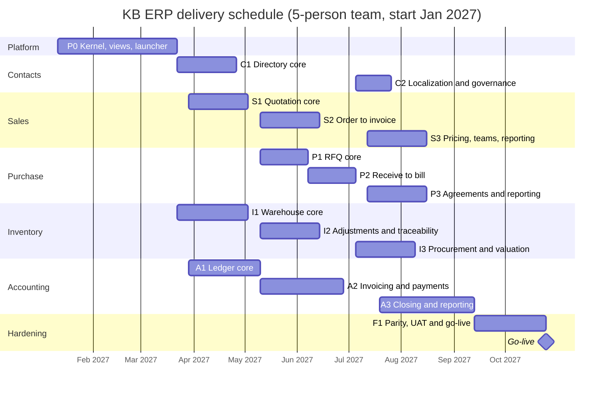

# KB ERP — Delivery Phases

| Field | Value |
|---|---|
| Product | **KB ERP** (`kberp`) |
| Version | 1.0 |
| Scope | Platform + five applications: **Contacts, Sales, Purchase, Inventory, Accounting** |
| Plan type | Phase-gated vertical slices with integration gates between releases |
| Baseline | Odoo 19 menu and behaviour parity (`prd.md` §5.2) |
| Companion documents | [`prd.md`](prd.md) · [`architecture.md`](architecture.md) · [`rules.md`](rules.md) · [`design.md`](design.md) |
| Status | Approved for build |

---

## 1. How this plan works

| Rule | Detail |
|---|---|
| Phase IDs | `P0` platform · `C*` Contacts · `S*` Sales · `P*` Purchase · `I*` Inventory · `A*` Accounting · `F1` hardening |
| Minimum phases | Contacts has **two** (C1–C2); Sales, Purchase, Inventory and Accounting have **three** each |
| Cumulative scope | Each phase adds to the previous one; nothing is removed |
| Gate model | A phase may start when each dependency has frozen its API contract; it may exit only after every dependency has passed its exit criteria |
| Estimates | Engineer-weeks (ew); 1 ew = one engineer for one week, including tests and docs |
| Team assumption | 3 backend, 1 frontend, 0.7 QA, 0.3 design/PM ≈ 4 effective ew per calendar week |
| Menu parity | A phase unlocks only the menus listed in its scope; the full `prd.md` §5.2 tree is complete at F1 |
| No dead links | A menu is enabled only when its action exists; unfinished entries are absent, not broken (`rules.md` R-UI-09) |
| Document of record | This file owns phase scope and sequencing; `prd.md` §12 owns release content |

### 1.1 Phase lifecycle

```
entry review ──► build (vertical slice) ──► demo ──► exit review ──► next phase
     ▲                                                              │
     └──────────── scope change requires re-estimate and approval ──┘
```

A phase is a **vertical slice**: schema + service + XML views + menus + permissions +
tests + demo data. No phase delivers "only the backend" or "only the screens".

Dependencies allow **controlled overlap**: a consumer builds against a frozen service
contract while the producer finishes its UI, but the consumer cannot exit before the
producer's contract and integration tests pass. This is why the Gantt bars overlap
inside a release while the release gate remains hard.

---

## 2. Phase map

| Phase | Module | Theme | Release | Depends on | Estimate | Primary requirements |
|---|---|---|---|---|---|---|
| **P0** | Platform | Kernel, ORM, XML views, launcher, shell | R0 | — | 12 ew | FR-PLT-001…009, 011 |
| **C1** | Contacts | Directory core, hierarchy, banks, chatter | R1 | P0 | 5 ew | FR-CON-001…009, 011, 012 |
| **C2** | Contacts | Localization, data quality, import/merge | R3 | C1, A2, P2 | 3 ew | FR-CON-010, 013…016 |
| **S1** | Sales | Quotation core and confirmation | R1 | P0, C1 | 5 ew | FR-SAL-001…003, 008, 009 |
| **S2** | Sales | Order to invoice, fulfillment feedback | R2 | S1, I1, A1 | 5 ew | FR-SAL-004…006, 012 |
| **S3** | Sales | Pricing, teams, templates, reporting, automation | R3 | S2, A2, I3 | 4 ew | FR-SAL-007, 010, 011, 013…016 |
| **P1** | Purchase | RFQ core and receipt request | R2 | P0, C1 | 4 ew | FR-PUR-001…003, 006 |
| **P2** | Purchase | Receive to bill, 3-way match | R2 | P1, I1, A1 | 4 ew | FR-PUR-004, 005, 008 (display) |
| **P3** | Purchase | Agreements, approvals, reporting, landed costs | R3 | P2, I3, A2 | 4 ew | FR-PUR-007…012 |
| **I1** | Inventory | Warehouse core, transfers, quants | R1 | P0, C1 | 6 ew | FR-INV-001…004, 011 |
| **I2** | Inventory | Adjustments, lots/serials, packages, traceability | R2 | I1 | 5 ew | FR-INV-005, 006, 010 |
| **I3** | Inventory | Procurement, valuation, barcode, full config | R3 | I2, A1, P1 | 5 ew | FR-INV-007…010, 012, 013 |
| **A1** | Accounting | Ledger core, taxes, posting, basic invoices | R1 | P0, C1 | 6 ew | FR-ACC-001…005 |
| **A2** | Accounting | Invoicing, payments, reconciliation-lite, FX | R2 | A1, S2, P2 | 7 ew | FR-ACC-005…008, 011, 012 |
| **A3** | Accounting | Closing, reports, compliance, full parity | R3 | A2, I3, P3 | 8 ew | FR-ACC-009, 010, 013…017 |
| **F1** | All | Parity audit, hardening, migration, UAT, go-live | R3 | all | 6 ew | UAT-01…09, NFR-001…016 |

**Total effort: 89 engineer-weeks.** See §14 for the roll-up and calendar.

---

## 3. Schedule

### 3.1 Indicative windows

The schedule is resource-levelled for the team above and starts in January 2027.
It is a planning aid, not a contractual date; phase *order* and *gates* are binding.

| Window | Phases running | Milestone |
|---|---|---|
| Jan – Mar 2027 | P0 | **IG-0** launcher and shells |
| Mar – May 2027 | C1, S1, I1, A1 | **IG-1** R1 integration gate |
| May – Jul 2027 | S2, P2, I2, A2, P1 | **IG-2** R2 cross-app flows |
| Jul – Sep 2027 | I3, S3, P3, C2, A3 | **IG-3** R3 parity and valuation |
| Sep – Oct 2027 | F1 | **IG-F** UAT and go-live |
| Week of 25 Oct 2027 | Cutover | Production live |

### 3.2 Gantt (indicative)



### 3.3 Critical path

```
P0 → C1 → A1 → A2 → A3 → F1
```

Accounting is the long pole. Mitigations: start A1 in parallel with C1, keep the tax
engine behind a stable interface from A1, and run A2/A3 as two workstreams inside the
accounting track where dependencies allow.

---

## 4. Release gates

| Release | Content | Gate | Pass condition |
|---|---|---|---|
| **R0** | P0 | IG-0 | Launcher, five app shells, XML menus, partner/product CRUD, outbox roundtrip, CI green |
| **R1** | C1, S1, I1, A1 | IG-1 | Quote confirm creates a delivery; manual invoice posts a balanced entry; contact smart buttons read real counts |
| **R2** | P1, P2, S2, I2, A2 | IG-2 | Quote→delivery→invoice→payment and RFQ→receipt→bill→payment complete end to end |
| **R3** | P3, C2, S3, I3, A3 | IG-3 | Valuation posts to the ledger; reports reconcile; full menu parity per app |
| **GA** | F1 | IG-F | UAT-01…09 pass; no critical/high security findings; restore drill passed |

A release gate is a **demo plus an automated suite**, not a date. If a gate fails, the
next phase may start only on the unaffected modules; the failing module stays in
stabilisation.

---

## 5. P0 — Platform, shell and launcher

**Release** R0 · **Depends on** — · **Estimate** 12 ew · **Requirements** FR-PLT-001…009, FR-PLT-011; NFR-001, 005, 006, 014

**Goal.** Prove the architecture end to end with a runnable product skeleton: one
database, five app shells, XML-defined menus and views, a working launcher, and a
worker that delivers events. No business document is implemented yet.

**Menus unlocked.** Five app roots with icons and placeholder landing actions:
`Contacts` (sequence 20), `Sales` (30), `Accounting` (60), `Purchase` (135),
`Inventory` (140), plus administrator-only `Settings`.

**Scope.**

- **Foundation** — repository layout from `architecture.md` §5, Docker Compose (web,
  worker, PostgreSQL 16, Redis, Nginx), configuration, structured logging, health
  endpoints, Makefile, CI pipeline.
- **ORM** — model registry, field types, recordsets, domains, computed/inverse/related
  fields, company-dependent values, constraints, migrations, sequences, audit columns.
- **Metadata** — XML loader; list/form/kanban/search views; `inherit_id` + xpath;
  window actions; menus; ACLs; record rules; settings schema; translations.
- **Web** — routing, sessions, Argon2id, CSRF, JSON-RPC envelope, error mapping,
  static assets, 403/404 pages.
- **KWL client** — launcher, app switcher, app shell, menubar, breadcrumbs, router,
  RPC client, basic view renderers, toasts, permission notices.
- **Kernel** — company, user, group, partner (basic), country/state, currency/rate,
  UoM, product template/variant/category/attribute/packaging, pricelist, attachment.
  Shared product configuration screens (Categories, Attributes, Units & Packagings)
  are built once here and linked from app menus later.
- **Chatter core** — messages, followers, activities, activity types and plans,
  attachments; used by every document phase.
- **Platform services** — outbox + worker, `ir.cron`, bus, jobs, audit log, settings,
  sequences, API keys.
- **Data and parity** — KES demo company, seed partners/products, committed
  `tests/parity/menus.json` fixture, `check-menus` and `check-views` CI scripts.

**Deliverables.** Running Compose stack; installable/upgradable module set; launcher
and shell; generic CRUD for partner and product; chatter on both; worker consuming
events; parity fixture and checks; ADRs for ORM, view engine and client; developer
README.

**Exit criteria.**

- `docker compose up` → login → `/apps` shows five cards in sequence order, reachable
  by keyboard, with working app switcher and deep links.
- Every app shell renders its menu tree from the database; no label is hard-coded in
  the client; root parity diff = 0.
- Partner and product can be created and edited through generic views; audit rows and
  a chatter message are written.
- An outbox event is emitted in a transaction, consumed by the worker, and a failing
  handler is retried then dead-lettered.
- Install and upgrade are idempotent on a blank database; lint, types, unit,
  integration and view/menu checks are green.
- p95 list query < 800 ms on 10,000 seeded partners; no N+1 in the list path.

**Demo script.**

| # | Action | Expected |
|---|---|---|
| 1 | Boot the stack and sign in as administrator | Launcher shows five apps with icons and descriptions |
| 2 | Click **Sales**, then the grid icon, then **Inventory** | App switches without reload; URL becomes `/apps/inventory` |
| 3 | Open `/apps/accounting` in a new tab | Same shell, Accounting menus, breadcrumbs correct |
| 4 | Create a product category, unit of measure and product | Saved, audited, visible through the API |
| 5 | Emit a test event; open Settings → Technical → Events | Event shows `processed`; worker log shows the handler |

**Deferred.** All business menus and documents, reports, stock, ledger, payments,
imports and the Contacts/Sales/Purchase/Inventory/Accounting parity trees.

---

## 6. Contacts

### C1 — Contact directory core

**Release** R1 · **Depends on** P0 · **Estimate** 5 ew · **Requirements** FR-CON-001…009, 011, 012

**Goal.** Deliver the shared partner directory that every other app consumes: people,
companies, addresses, hierarchy, tags, industries, banks and chatter.

**Menus unlocked.**

- `Contacts → Contacts`
- `Contacts → Configuration → Contact Tags`
- `Contacts → Configuration → Industries`
- `Contacts → Configuration → Bank Accounts → Banks`
- `Contacts → Configuration → Bank Accounts → Bank Accounts`

**Scope.**

- Partner fields: `is_company`, `parent_id`, `type` (contact/invoice/delivery/other),
  name, function, email, phone, mobile, website, VAT, company registry, industry,
  tags, language, full address block, active.
- Computed and stored: `complete_name` (`"Company, Person"`), `commercial_partner_id`,
  `address_get(types)` with descendant/ancestor fallback.
- Sync rules: address fields flow company → `type=contact` children; VAT flows up;
  company registry and industry delegate to the commercial entity.
- Views: list (name, email, phone, salesperson, city, country, tags, statistics),
  kanban (avatar, parent badge, tags), form (Person/Company radio, header, tabs
  **Contacts / Sales & Purchase / Invoicing / Notes**), search with Persons,
  Companies and Archived filters, group by salesperson/company/country/tags.
- Configuration: hierarchical contact tags with colours; industries; bank directory;
  bank accounts with sanitised, per-partner unique account numbers and uppercase BIC.
- Chatter, followers, activities; smart buttons for Sales, Purchases, Invoiced,
  Vendor Bills and Lots/Serials, showing real counts once the producing phase ships.
- Security parity with Odoo 19: internal users read-only; create/write/delete only via
  the partner-manager group; company record rule; masked bank/VAT fields in logs.
- Archive instead of delete; block archiving a partner linked to an active user;
  block deletion when referenced (FK `RESTRICT`).

**Deliverables.** Partner schema and services, address/commercial sync, contact views,
tags, industries, banks and bank accounts, chatter, security rules, seed contacts,
tests for every invariant in `rules.md` §9.

**Exit criteria.**

- UAT-02 passes: company + two addresses + tag + bank account, correct
  `complete_name`, address sync in both directions.
- Address sync, VAT sync, commercial partner, parent-cycle and bank uniqueness tests
  pass; deleting a referenced partner is blocked with a readable message.
- A user without the partner-manager group sees contacts read-only and receives 403
  on direct write attempts.
- Contact list, kanban and form meet the `design.md` §7.1 specification.
- C1 menu scope passes the parity check with zero differences.

**Demo script.**

| # | Action | Expected |
|---|---|---|
| 1 | Create **Apex Logistics Ltd** with VAT, industry, tag and bank account | Saved; bank number normalised; duplicate account rejected |
| 2 | Add invoice and delivery addresses | `complete_name` reads "Apex Logistics Ltd, Nairobi Warehouse"; address inherited |
| 3 | Change the company street | `type=contact` children update; invoice address unchanged |
| 4 | Change a child's VAT | Company VAT updates; registry and industry stay delegated |
| 5 | Open the kanban grouped by country and filter by tag | Cards show avatars, parent badges and counts |
| 6 | Try to archive a partner linked to a user, then archive a free one | First blocked with explanation; second hidden from selection |

**Deferred.** Countries/states/groups screens, duplicate detection, merge, import and
full smart-button aggregates (C2); document creation (other modules).

### C2 — Localization, data quality and governance

**Release** R3 · **Depends on** C1, A2, P2 · **Estimate** 3 ew · **Requirements** FR-CON-010, 013…016

**Goal.** Make the directory trustworthy at scale: country-aware addresses, duplicate
control, imports, merges and final archive/delete governance against live documents.

**Menus unlocked.**

- `Contacts → Configuration → Localization → Countries`
- `Contacts → Configuration → Localization → Fed. States`
- `Contacts → Configuration → Localization → Country Group`

**Scope.**

- Seed and administer countries, states and country groups (reference shape: 251
  countries, 2,131 states, 10 groups); country-aware address format, VAT label and
  default country.
- Duplicate VAT/company-registry detection with a warning and a link to the existing
  partner; saving remains allowed.
- Merge wizard that re-points sale orders, purchase orders, invoices and pickings to
  the surviving partner, then archives the duplicate with an audit trail.
- Import/export: downloadable templates, column mapping, validation, all-or-nothing
  batches, error file, idempotent external key, progress job.
- Final governance: archive/delete guards evaluated against all document references;
  contact-creation setting mirrors `base.group_partner_manager`.
- Geolocation fields and an address-autocomplete adapter hook; partner-enrichment
  adapter present but disabled by default.
- Activity types for contacts; saved filters and list export; smart-button aggregates
  (Invoiced, Vendor Bills, Sales, Purchases, Lots/Serials) through query services.

**Deliverables.** Localization screens and seeds, duplicate/merge services, import and
export jobs, governance guards, enrichment hooks, Contacts parity fixture (full tree).

**Exit criteria.**

- Duplicate VAT shows a warning and a working link; merge keeps every document linked
  and archives the duplicate.
- A 500-row import succeeds; an invalid batch produces a downloadable error file and
  writes nothing.
- Changing a partner's country re-formats its address block and VAT label.
- Archive/delete guards hold with real invoices, orders and pickings present.
- Full Contacts menu parity diff = 0; no dead links.

**Demo script.**

| # | Action | Expected |
|---|---|---|
| 1 | Create a second partner with Apex's VAT | Warning with link; save allowed |
| 2 | Merge the duplicate into Apex | Orders and invoices re-pointed; duplicate archived |
| 3 | Import 500 contacts with 3 bad rows | Batch rejected; error file lists the 3 rows; nothing written |
| 4 | Change country from Kenya to Uganda | Address format and VAT label change |
| 5 | Open a contact with invoices and pickings | Smart buttons show real totals and counts |

**Deferred.** External enrichment provider credentials; bulk geocoding beyond the
adapter hook.

---

## 7. Sales

### S1 — Quotation core and confirmation

**Release** R1 · **Depends on** P0, C1 · **Estimate** 5 ew · **Requirements** FR-SAL-001…003, 008, 009

**Goal.** Quote to a confirmed sales order, with correct pricing, taxes and a delivery
request created in Inventory in the same transaction.

**Menus unlocked.**

- `Sales → Orders → Quotations`
- `Sales → Orders → Orders`
- `Sales → Orders → Customers`
- `Sales → Products → Products`
- `Sales → Configuration → Settings`

**Scope.**

- `sales.order` and `sales.order_line`: customer, invoice/delivery addresses,
  pricelist, payment terms, currency, validity, salesperson, reference, tags, notes;
  product, description, quantity, UoM, unit price, discount, taxes, subtotal.
- Defaults from the customer: addresses, pricelist, payment terms, salesperson;
  currency from the pricelist; taxes from the product and fiscal position.
- Totals: untaxed, tax groups, total, rounding per currency; discount policy from
  settings.
- State machine `draft → sent → sale → cancel`, status bar labels Quotation /
  Quotation Sent / Sales Order / Cancelled; reset to draft where allowed.
- Send quotation (email composer with QWeb PDF attached); confirmation creates one
  delivery per warehouse group through `inventory.api.create_delivery`; cancel
  cancels linked non-done pickings; sequence `SO/YYYY/NNNNN`.
- Views: list, kanban, form, search; chatter; smart buttons for deliveries and
  invoices; access groups for sales user and manager.
- Settings: quotation validity, invoice policy (basic), discounts, lock (off).

**Deliverables.** Sales schema and services, pricing/tax integration, PDF template,
state transitions, views, security, tests for R-SAL-001…003 and 012.

**Exit criteria.**

- Totals and tax tests pass for discounts, multiple tax groups and currency rounding.
- Confirm creates exactly one delivery per warehouse group; a delivery failure rolls
  the whole transaction back and leaves the order in `draft`.
- Quotation PDF renders addresses, lines, taxes and terms; email sends with attachment.
- Cancel cancels linked draft pickings; reset to draft restores editability.
- S1 menu scope passes parity with zero differences.

**Demo script.**

| # | Action | Expected |
|---|---|---|
| 1 | Create a quotation for Apex Logistics | Addresses, pricelist, terms and salesperson default correctly |
| 2 | Add three products with quantities and a 5 % discount | Totals and tax groups recompute inline |
| 3 | Preview and send the quotation | PDF correct; state becomes Quotation Sent |
| 4 | Confirm the order | State Sales Order; delivery smart button shows one picking |
| 5 | Cancel a fresh quotation | Linked draft picking is cancelled; no accounting entry |

**Deferred.** Invoicing, delivered/invoiced quantities, lock, upsell (S2); pricelists,
teams, templates, reports, automation (S3).

### S2 — Order to invoice and fulfillment feedback

**Release** R2 · **Depends on** S1, I1, A1 · **Estimate** 5 ew · **Requirements** FR-SAL-004…006, 012

**Goal.** Close the loop from confirmed order to delivered and invoiced quantities,
with the To Invoice and Upsell queues behaving like Odoo.

**Menus unlocked.**

- `Sales → To Invoice → Orders to Invoice`
- `Sales → To Invoice → Orders to Upsell`
- `Sales → Configuration → Sales Orders → Headers/Footers`
- `Sales → Configuration → Sales Orders → Tags`

**Scope.**

- Invoice policy **ordered** or **delivered**; "Create Invoice" through
  `accounting.api.create_invoice` with matching partner, currency, taxes, terms and
  `invoice_origin`; down-payment wizard; pro-forma invoice option.
- `invoice_status`: Nothing to Invoice / To Invoice / Fully Invoiced / Upselling
  Opportunity; `qty_delivered` updated from `inventory.picking.done`;
  `qty_invoiced` from `accounting.move.posted`; upsell candidates where invoiced
  exceeds ordered.
- Cancel cancels non-done pickings and draft invoices; lock confirmed orders
  (read-only except notes/attachments); over-delivery and over-invoice guards.
- To Invoice and Upsell queues with filters and grouping; quotation headers/footers;
  order tags.
- Credit-note link from a posted invoice back to the order.

**Deliverables.** Invoice creation and down payment, event handlers for delivered and
invoiced quantities, queues, lock and guards, headers/footers, tags, tests for
R-SAL-004…010.

**Exit criteria.**

- UAT-03 passes through payment: quote → confirm → deliver → invoice → post → pay.
- Partial delivery and partial invoice produce Partial statuses and correct residuals.
- Over-invoicing is blocked (or allowed only when the policy explicitly permits it).
- Locked orders reject writes server-side; event handlers are idempotent.
- S2 menu scope passes parity; no dead links.

**Demo script.**

| # | Action | Expected |
|---|---|---|
| 1 | Confirm and deliver half of an order | `qty_delivered` reflects the delivery; status Partial |
| 2 | Create an invoice for the delivered quantity | Draft invoice with the same taxes and terms |
| 3 | Post and pay the invoice | Payment state Paid; order shows Fully Invoiced |
| 4 | Try to invoice more than ordered | Blocked with an explanation |
| 5 | Lock the order and edit a line | Edit rejected; notes still editable |

**Deferred.** Pricelists, teams, templates, reports, recurring invoices, credit limit
(S3); credit-note creation UI (A2).

### S3 — Pricing, teams, templates, reporting and automation

**Release** R3 · **Depends on** S2, A2, I3 · **Estimate** 4 ew · **Requirements** FR-SAL-007, 010, 011, 013…016

**Goal.** Complete the Sales application surface: configurable pricing, sales teams,
quotation templates, analysis reports, automation and settings parity.

**Menus unlocked.**

- `Sales → Orders → Sales Teams`
- `Sales → Products → Product Variants`
- `Sales → Products → Pricelists`
- `Sales → Reporting → Sales`, `Salespersons`, `Products`, `Customers`
- `Sales → Configuration → Sales Teams`
- `Sales → Configuration → Sales Orders → Quotation Templates`
- `Sales → Configuration → Sales Orders → Delivery Methods` (links I3 action)
- `Sales → Configuration → Products → Attributes`, `Combo Choices`, `Categories`,
  `Product Tags`, `Units & Packagings`
- `Sales → Configuration → Online Payments → Payment Providers`, `Payment Methods`,
  `Payment Tokens`, `Payment Transactions` (links A2 registry)
- `Sales → Configuration → Activities → Activity Types`, `Activity Plans` (links P0)

**Scope.**

- Pricelists: currency, fixed/percentage/formula rules, minimum quantity, date ranges,
  product/category/variant criteria; price recomputation on customer, date or quantity
  change.
- Product variants and attributes UI; combo choices; product tags.
- Sales teams: members, targets, assignment rules, this-month invoiced; salesperson
  defaults from the customer.
- Quotation templates with headers/footers, lines and optional products.
- Reports: Sales, Salespersons, Products and Customers as pivot/graph/list with date,
  team, salesperson, product and customer filters; totals reconcile with orders.
- Automation: recurring invoices and quotation expiry via `ir.cron`; credit-limit
  check using accounting balances plus open orders; customer warning on confirmation.
- Online payment provider registry (shared with A2); payment link on quotations.
- Settings parity: pricelists, discounts, teams, pro-forma, online payments, lock.

**Exit criteria.**

- A pricing matrix test (product × quantity × currency × date) returns expected prices.
- Report totals equal the sum of confirmed order lines for the same filters.
- Cron creates recurring invoices and expires quotations exactly once per period.
- Credit limit blocks confirmation only when the policy is enabled.
- Full Sales menu parity diff = 0; all actions resolve; no dead links.

**Demo script.**

| # | Action | Expected |
|---|---|---|
| 1 | Create a 10 % pricelist for a customer segment | New quotations use it; manual override is audited |
| 2 | Create a team with a target and assign Apex | Team kanban shows members and invoiced-to-date |
| 3 | Add a quotation template with an optional product | New quotation pre-fills lines; optional product can be added |
| 4 | Open Sales analysis and group by team and month | Totals match the order list |
| 5 | Run the expiry cron | Expired quotations are marked; nothing else changes |

**Deferred.** Native card acquiring and marketplace integrations (adapter only).

---

## 8. Purchase

### P1 — RFQ core and receipt request

**Release** R2 · **Depends on** P0, C1 · **Estimate** 4 ew · **Requirements** FR-PUR-001…003, 006

**Goal.** Create RFQs, select vendor prices and confirm a purchase order that requests
a receipt in Inventory.

**Menus unlocked.**

- `Purchase → Orders → Requests for Quotation`
- `Purchase → Orders → Purchase Orders`
- `Purchase → Orders → Vendors`
- `Purchase → Products → Products`
- `Purchase → Configuration → Settings`
- `Purchase → Configuration → Vendor Pricelists`

**Scope.**

- `purchase.order` and `purchase.order_line`: vendor, currency, payment terms, buyer,
  expected arrival, incoterm, reference, lines with product, quantity, price, taxes
  and subtotal.
- Vendor defaults and vendor-price selection (vendor + product + quantity + currency +
  date); currency and price frozen after confirmation.
- State machine `draft → sent → purchase → cancel` with RFQ / RFQ Sent / Purchase
  Order / Cancelled labels; sequence `PO/YYYY/NNNNN`.
- Send RFQ email with QWeb PDF; confirm creates a receipt through
  `inventory.api.create_receipt`; cancel cancels non-done receipts.
- Views: list, kanban, form, search; chatter; smart buttons for receipts and bills.
- Receipt and invoice status fields computed as stubs (real events in P2).
- Settings: lock, warnings, bill control (basic), variants/UoM/packagings.

**Deliverables.** Purchase schema and services, vendor pricing, PDF, state machine,
views, security, tests for R-PUR-001…003 and 006.

**Exit criteria.**

- Confirm creates exactly one receipt per warehouse group and rolls back atomically on
  failure.
- Vendor price precedence is correct for quantity breaks, currency and dates.
- RFQ PDF and email work; cancel cancels draft receipts.
- P1 menu scope passes parity; no dead links.

**Demo script.**

| # | Action | Expected |
|---|---|---|
| 1 | Create an RFQ for a vendor with a vendor pricelist | Price and lead time default from the vendor price |
| 2 | Add a second line with a quantity break | Correct price tier applied |
| 3 | Send and confirm the RFQ | State Purchase Order; receipt smart button shows a picking |
| 4 | Cancel a fresh RFQ | Linked receipt cancelled |
| 5 | Print the PO | Vendor address, incoterm and lines correct |

**Deferred.** Receipt status, bill control and bill creation (P2); agreements,
approvals, reports, reminders, landed costs (P3).

### P2 — Receive to bill and 3-way match

**Release** R2 · **Depends on** P1, I1, A1 · **Estimate** 4 ew · **Requirements** FR-PUR-004, 005, 008 (display)

**Goal.** Track receipts and produce vendor bills that respect the configured control
policy, with a three-way match between ordered, received and billed quantities.

**Menus unlocked.** No new menu entries; existing order screens gain receipt and
billing actions, smart buttons and status chips.

**Scope.**

- `receipt_status` Not Received / Partially Received / Fully Received and
  `qty_received` updated from `inventory.picking.done`.
- `invoice_status` Nothing to Bill / Waiting Bills / Fully Billed; "Create Bill"
  through `accounting.api.create_bill` with matching lines, taxes and terms.
- Bill control policy: ordered, received, or received quantity; over-billing blocked;
  three-way match view on the order.
- Cancel a confirmed PO cancels non-done receipts; lock confirmed orders; vendor
  warning displayed on confirmation.
- Partial receipt and partial billing scenarios; bill reference and due date.

**Deliverables.** Receipt event handlers, bill creation, 3-way match service and
screen, lock, tests for R-PUR-004…009.

**Exit criteria.**

- UAT-04 passes through payment: RFQ → confirm → receive (partial, then full) → bill →
  post → pay.
- Bill control blocks billing when the receipt is missing under the "received" policy.
- Over-billing and duplicate billing are blocked; handlers are idempotent.
- Locked POs reject writes server-side; no dead links.

**Demo script.**

| # | Action | Expected |
|---|---|---|
| 1 | Receive 40 of 100 units | Receipt status Partially Received; `qty_received` = 40 |
| 2 | Try to bill 100 under the "received" policy | Blocked with an explanation |
| 3 | Bill the 40 received units | Draft bill with matching lines and taxes |
| 4 | Receive and bill the remainder | Status Fully Received / Fully Billed |
| 5 | Lock the PO and edit a price | Rejected; notes remain editable |

**Deferred.** Agreements, approvals, reporting, reminders, customs/landed costs (P3).

### P3 — Agreements, approvals, reporting and landed costs

**Release** R3 · **Depends on** P2, I3, A2 · **Estimate** 4 ew · **Requirements** FR-PUR-007…012

**Goal.** Complete the Purchase application surface: blanket agreements, approval
control, vendor performance, analysis and import costs.

**Menus unlocked.**

- `Purchase → Orders → Purchase Agreements`
- `Purchase → Products → Product Variants`
- `Purchase → Reporting → Purchase`
- `Purchase → Configuration → Products → Attributes`, `Categories`,
  `Units & Packagings` (shared kernel actions)

**Scope.**

- Purchase agreements / blanket orders with validity, lines, ordered vs called-off
  quantities and call-off RFQs.
- Double validation and approval threshold; manager approval queue; audit of
  approvals; server-side enforcement.
- Receipt reminder email with days-before setting via `ir.cron`; vendor warnings.
- Vendor on-time rate and purchase-line suggestions from history.
- Purchase analysis by vendor, product, category and date (pivot/graph/list).
- Customs imports and landed costs: cost lines allocated to receipts, valuation
  adjustment through inventory/accounting services.

**Exit criteria.**

- Approval is enforced for users below the threshold and cannot be bypassed by API.
- Agreement call-offs never exceed the agreed quantity or validity.
- Purchase analysis totals reconcile with confirmed order lines.
- Landed cost updates stock value and posts a balanced entry.
- Full Purchase menu parity diff = 0; no dead links.

**Demo script.**

| # | Action | Expected |
|---|---|---|
| 1 | Create a blanket agreement for 1,000 units | Lines show ordered and remaining quantities |
| 2 | Call off 200 units as an RFQ | Linked to the agreement; remaining 800 |
| 3 | Confirm above the approval threshold as a buyer | Order waits in To Approve; manager approves |
| 4 | Add a landed cost to a receipt | Stock value increases; balanced journal entry |
| 5 | Open purchase analysis by vendor | Totals reconcile with orders and bills |

**Deferred.** Supplier portals and EDI (post-v1); automated vendor scoring beyond the
on-time rate.

---

## 9. Inventory

### I1 — Warehouse core, transfers and quants

**Release** R1 · **Depends on** P0, C1 · **Estimate** 6 ew · **Requirements** FR-INV-001…004, 011

**Goal.** A correct stock ledger: warehouses, location trees, operation types, receipts,
deliveries, internal transfers, reservations, quants and the two core reports.

**Menus unlocked.**

- `Inventory → Overview`
- `Inventory → Operations → Transfers → Receipts`, `Deliveries`, `Internal`
- `Inventory → Products → Products`
- `Inventory → Reporting → Stock`, `Locations`
- `Inventory → Configuration → Settings`
- `Inventory → Configuration → Warehouse Management → Warehouses`, `Operations Types`,
  `Locations`

**Scope.**

- Warehouse and location tree with usages (internal, supplier, customer, inventory,
  production, transit); operation types with sequences (`WH/IN`, `WH/OUT`, `WH/INT`).
- `picking`, `move`, `move_line` and `quant`; demand vs done quantities; reservation by
  location hierarchy with FIFO/FEFO strategy; validate and backorder dialogs.
- Quant invariants: on-hand is always the sum of done move lines; negative stock blocked
  unless the product/company setting allows it; row locks prevent double reservation.
- Services `create_receipt`, `create_delivery`, `create_internal`, `reserve`,
  `validate`, `cancel`, `available_qty` — used synchronously by Sales and Purchase.
- Overview KPIs (to receive, to deliver, late transfers, stock value), stock report,
  location report; product form Inventory tab with on-hand, forecast and free quantity.
- Views: list, kanban, form, search; detailed operations editor; chatter; barcode field
  present but scanning deferred to I3.
- Settings: routes (off), storage locations, reservation method, packages (off), lots
  (off), valuation (periodic).

**Deliverables.** Inventory schema and services, reservation and validation, quants,
overview, reports, security, demo warehouse, tests for R-INV-001…005 and 008, 009, 011.

**Exit criteria.**

- Quant reconciliation query returns zero differences after a scripted receipt,
  delivery, internal transfer and backorder.
- Two concurrent reservations cannot take the same quant; a negative-stock attempt is
  rejected with a readable message.
- Quote confirmation creates a delivery and PO confirmation creates a receipt through
  the service API (no cross-schema writes).
- UAT-05 (transfers portion) passes; list and form meet `design.md` §7.4.
- I1 menu scope passes parity; no dead links.

**Demo script.**

| # | Action | Expected |
|---|---|---|
| 1 | Receive 100 units into stock | Quant increases; receipt Done; stock report reflects it |
| 2 | Deliver 30 units to a customer | Quant decreases; customer location increases |
| 3 | Transfer 10 units between internal locations | Total on-hand unchanged |
| 4 | Validate a partial delivery with a backorder | Backorder picking created with the remainder |
| 5 | Confirm a quotation in Sales | Delivery picking appears in Inventory automatically |

**Deferred.** Adjustments, lots/serials, packages (I2); routes, valuation, barcode,
full configuration and performance (I3).

### I2 — Adjustments, lots/serials, packages and traceability

**Release** R2 · **Depends on** I1 · **Estimate** 5 ew · **Requirements** FR-INV-005, 006, 010

**Goal.** Make stock auditable and traceable: counted, corrected, scrapped, tracked by
lot or serial, packed and traceable from receipt to delivery.

**Menus unlocked.**

- `Inventory → Operations → Adjustments → Physical Inventory`, `Scrap`
- `Inventory → Products → Lots / Serial Numbers`, `Packages`
- `Inventory → Reporting → Moves History`, `Moves Analysis`
- `Inventory → Configuration → Delivery → Package Types`

**Scope.**

- Physical inventory count sheet: counted vs theoretical, difference, adjustment moves
  to the inventory location; count by product/location/lot.
- Scrap form and scrap location; scrap move reduces on-hand and emits a valuation
  payload (posting in I3).
- Lots and serial numbers with uniqueness per product/company; expiry dates when the
  setting is on; lot/serial selection on receipts, deliveries and transfers.
- Packages and package types; package contents; move lines carry package and owner.
- Traceability view: receipt → internal moves → delivery for a lot or serial.
- Moves History and Moves Analysis reports with date, product, location and state
  filters; drill-down to the picking.
- Adjustment and scrap audit trail; no direct quant edits.

**Deliverables.** Count and scrap flows, lot/serial models and UI, packages, traceability
queries, two reports, tests for R-INV-005, 006, 010.

**Exit criteria.**

- A count corrects the quant and writes an adjustment move; the stock report matches.
- Scrap reduces on-hand and is valued; the audit trail names the user and reason.
- Lot/serial uniqueness holds; traceability returns the full chain for a test lot.
- Package contents reconcile with move lines; moves analysis totals equal move history.
- I2 menu scope passes parity; no dead links.

**Demo script.**

| # | Action | Expected |
|---|---|---|
| 1 | Count 8 units where 10 are expected | Adjustment move −2; quant corrected; reason recorded |
| 2 | Scrap 1 damaged unit | On-hand down; scrap location up; valuation payload emitted |
| 3 | Receive a tracked product with two serials | Two serials created and linked to the receipt |
| 4 | Deliver one serial and open traceability | Chain receipt → stock → delivery is complete |
| 5 | Pack 12 units and open Moves Analysis | Package contents and totals reconcile |

**Deferred.** Routes/reordering, valuation postings, barcode scanning, putaway,
performance report (I3).

### I3 — Procurement, valuation, barcode and full configuration

**Release** R3 · **Depends on** I2, A1, P1 · **Estimate** 5 ew · **Requirements** FR-INV-007…010, 012, 013

**Goal.** Automate replenishment, value stock in the ledger, support barcode operations
and complete the Inventory configuration and reporting surface.

**Menus unlocked.**

- `Inventory → Operations → Procurement → Replenishment`, `References`
- `Inventory → Operations → Procurement: run scheduler`
- `Inventory → Products → Product Variants`
- `Inventory → Reporting → Performance`
- `Inventory → Configuration → Warehouse Management → Routes`, `Rules`,
  `Storage Categories`, `Putaway Rules`
- `Inventory → Configuration → Products → Categories`, `Attributes`,
  `Units & Packagings`, `Barcode Nomenclatures`
- `Inventory → Configuration → Delivery → Delivery Methods`, `Zip Prefix`

**Scope.**

- Routes and rules: buy, make-to-order, drop-ship, cross-dock; rule chaining with
  delays; route selection on product/warehouse.
- Reordering rules (min/max, multiple, to-order) and the scheduler; replenishment
  creates RFQs through `purchase.api` and shows forecast vs to-order.
- Putaway rules and storage categories; package-type constraints.
- Valuation: periodic (manual closing) and perpetual (automatic entries) modes;
  valuation layers per move; entries posted through `accounting.api` with idempotency
  keyed on `move_id`; stock valuation report.
- Barcode nomenclature and scan-to-transfer client (receipt, delivery, internal,
  count); invalid barcode feedback.
- Delivery methods (shared action with Sales) and zip-prefix rules; performance report.
- Landed-cost valuation hook used by Purchase P3.

**Exit criteria.**

- The scheduler creates exactly one RFQ per triggered orderpoint and never duplicates.
- Perpetual valuation produces balanced entries for receipt, delivery, scrap and count;
  the valuation report reconciles with the general ledger.
- Barcode scanning completes a receipt and a delivery on a test device profile.
- Internal transfers never create valuation entries.
- Full Inventory menu parity diff = 0; no dead links.

**Demo script.**

| # | Action | Expected |
|---|---|---|
| 1 | Set an orderpoint at min 20 / max 50 and run the scheduler | RFQ for the shortfall appears in Purchase |
| 2 | Receive and deliver with perpetual valuation on | Balanced stock-in and COGS entries |
| 3 | Scan a receipt with the barcode client | Lines and quantities fill from the barcode |
| 4 | Open stock valuation and the trial balance | Inventory value matches the ledger |
| 5 | Configure a putaway rule and receive | Product lands in the suggested location |

**Deferred.** Multi-step quality routes, wave picking and robotics integrations.

---

## 10. Accounting

### A1 — Ledger core, taxes and posting

**Release** R1 · **Depends on** P0, C1 · **Estimate** 6 ew · **Requirements** FR-ACC-001…005

**Goal.** A correct double-entry ledger with a chart of accounts, journals, taxes and
immutable postings — the foundation every other app posts into.

**Menus unlocked.**

- `Accounting → Dashboard` (basic KPIs)
- `Accounting → Customers → Invoices`
- `Accounting → Vendors → Bills`
- `Accounting → Accounting → Transactions → Journal Entries`
- `Accounting → Configuration → Settings`
- `Accounting → Configuration → Accounting → Chart of Accounts`, `Taxes`,
  `Tax Groups`, `Journals`, `Fiscal Years`, `Currencies`

**Scope.**

- Chart of accounts with hierarchical codes and account types; journals for sale,
  purchase, bank, cash and general with sequences and default accounts.
- Taxes: percentage and fixed, included/excluded, repartition lines, tax groups,
  rounding per line or per total; tax engine used by Sales and Purchase.
- Fiscal year and periods; currencies and rates from the kernel.
- `accounting.move` and `move_line`: draft → posted → cancel; balance validation;
  sequence allocation inside the posting transaction; immutability after posting;
  audit log for every posting and cancellation.
- Basic customer invoices and vendor bills (draft, post, cancel) with receivable and
  payable lines; manual journal entries with a balance indicator.
- Views: list, form, search; status bar; chatter; dashboard with draft/posted counts
  and bank balances.
- Security: billing, readonly, user, manager and auditor groups; company rule; posted
  entries read-only for everyone.

**Deliverables.** Ledger schema, chart and journals, tax engine, posting service,
sequences, basic invoice/bill flows, dashboard, security, tests for R-ACC-001…006
and 012.

**Exit criteria.**

- A balanced entry posts and allocates a contiguous number; an unbalanced entry is
  rejected with debit and credit shown.
- Posted entries reject every update and delete, including by administrators;
  reversal is the only correction path.
- Tax engine tests cover included/excluded, fixed, multiple taxes and both rounding
  modes; invoice totals equal untaxed + taxes.
- Invoice posting creates the receivable/payable and updates the account balances.
- A1 menu scope passes parity; no dead links.

**Demo script.**

| # | Action | Expected |
|---|---|---|
| 1 | Open the chart of accounts and create a journal | Account hierarchy and journal sequence work |
| 2 | Post a manual entry with two lines | Balanced; number assigned; audit row written |
| 3 | Try to post an unbalanced entry | Rejected: debit 1,200.00 vs credit 1,150.00 |
| 4 | Post an invoice, then try to edit it | Edit rejected; posted entry is immutable |
| 5 | Open the dashboard | Draft/posted totals and bank balance match the ledger |

**Deferred.** Credit notes, payments and reconciliation (A2); reports, closing, assets,
follow-ups, e-invoicing (A3).

### A2 — Invoicing, payments, reconciliation and multi-currency

**Release** R2 · **Depends on** A1, S2, P2 · **Estimate** 7 ew · **Requirements** FR-ACC-005…008, 011, 012

**Goal.** Complete the receivables and payables cycle: invoices, credit notes, bills,
refunds, payments, partial reconciliation and foreign currency.

**Menus unlocked.**

- `Accounting → Customers → Credit Notes`, `Payments`, `Products`, `Customers`
- `Accounting → Vendors → Refunds`, `Payments`, `Employee Expenses`, `Products`,
  `Vendors`
- `Accounting → Configuration → Accounting → Fiscal Positions`
- `Accounting → Configuration → Invoicing → Payment Terms`

**Scope.**

- Full invoice, credit note, bill and refund forms with lines, taxes, payment terms,
  due dates, journal, currency and reference; link to the originating sale or purchase
  order; credit note created from an invoice with lines pre-filled.
- Payments (inbound/outbound) with journal, method, amount, currency, partner and
  memo; allocation to one or more invoices; partial payments; overpayment blocked;
  `payment_state` and `amount_residual` computed from reconciled amounts.
- Basic reconciliation: match receivable/payable lines, partial amounts and write-off;
  full reconciliation widget and bank statements in A3.
- Fiscal positions mapping taxes and accounts by country, country group, zip or VAT;
  applied automatically on documents.
- Multi-currency: company currency vs document currency, historical rate frozen,
  exchange-difference entries on payment.
- Partner statistics: total invoiced, credit, debit, credit to invoice, days sales
  outstanding; employee expenses as a vendor-bill filter; customer/vendor/product
  menus linked to shared actions.
- Invoice and bill integration with Sales S2 and Purchase P2.

**Deliverables.** Credit notes/refunds, payments and allocation, reconciliation, fiscal
positions, FX, partner statistics, tests for R-ACC-007…009, 011 and 013.

**Exit criteria.**

- UAT-03 and UAT-04 pass end to end through payment.
- Partial payments produce Partial status with correct residuals; overpayment is
  rejected; a payment can be allocated across invoices.
- A credit note reconciles against its invoice and updates partner balances.
- A foreign-currency invoice and payment produce a balanced exchange-difference entry.
- A2 menu scope passes parity; no dead links.

**Demo script.**

| # | Action | Expected |
|---|---|---|
| 1 | Create and post a credit note from an invoice | Lines and taxes pre-filled; receivable reduced |
| 2 | Register a 40 % payment on an invoice | Payment state Partial; residual correct |
| 3 | Pay the remainder from the bank journal | Payment state Paid; receivable reconciled |
| 4 | Invoice in USD to a KES company and pay at a different rate | Exchange-difference entry; ledger balanced |
| 5 | Enable a fiscal position for a country and invoice | Taxes and accounts remapped automatically |

**Deferred.** Full reconciliation widget, bank statements, lock dates, reports, assets,
follow-ups, analytic and e-invoicing (A3).

### A3 — Closing, reporting, compliance and full parity

**Release** R3 · **Depends on** A2, I3, P3 · **Estimate** 8 ew · **Requirements** FR-ACC-009, 010, 013…017

**Goal.** Close the books, produce the statements and controls, and reach full
Accounting menu parity including assets, analytics and e-invoicing.

**Menus unlocked.**

- `Accounting → Accounting → Transactions → Analytic Items`
- `Accounting → Accounting → Assets & Liabilities → Assets`, `Loans`
- `Accounting → Accounting → Closing → Reconcile`, `Tax Returns`, `Lock Dates…`,
  `Secure Entries`
- `Accounting → Accounting → Review → Control → Journal Items`, `Journal Audit`
- `Accounting → Accounting → Review → Audit → Working Files`
- `Accounting → Accounting → Review → Inventory → Inventory Valuation`,
  `Depreciation Schedule`, `Loans Analysis`
- `Accounting → Accounting → Review → Regularization Entries → Unrealized Currencies`,
  `Deferred Revenues`, `Deferred Expenses`
- `Accounting → Accounting → Review → Purchases → Billed Not Received`,
  `Bill To Receive`
- `Accounting → Accounting → Review → Sales → Invoices To Be Issued`,
  `Invoiced Not Delivered`
- `Accounting → Accounting → Review → Logs → Audit Trail`
- `Accounting → Accounting → Reporting → Statement Reports → Cash Flow Statement`,
  `Balance Sheet`, `Profit and Loss`
- `Accounting → Accounting → Reporting → Ledgers → Trial Balance`, `General Ledger`
- `Accounting → Accounting → Reporting → Partner Reports → Partner Ledger`,
  `Aged Payable`, `Aged Receivable`
- `Accounting → Accounting → Reporting → Taxes & Fiscal → Tax Report`,
  `EC Sales List`, `Fiscal Report`
- `Accounting → Accounting → Reporting → Management → Invoice Analysis`,
  `Analytic Report`, `Executive Summary`
- `Accounting → Configuration → Accounting → Chart of Accounts`, `Taxes`,
  `Tax Groups`, `Tax Units`, `Journals`, `Fiscal Positions`, `Fiscal Years`,
  `Currencies`, `Account Groups`, `Account Tags`, `Fiscal Categories`,
  `Multi-Ledger`, `Cash Roundings`, `Checks`, `Return Types`, `Financial Budgets`,
  `Asset Models`, `Accounting Reports`, `Horizontal Groups`,
  `Online Synchronization`
- `Accounting → Configuration → KRA eTIMS → KE OSCU Codes`, `KE OSCU Notices`
- `Accounting → Configuration → Invoicing → Follow-up Levels`, `Incoterms`,
  `Product Categories`
- `Accounting → Configuration → Online Payments → Payment Providers`,
  `Payment Methods`, `Payment Tokens`, `Payment Transactions`
- `Accounting → Configuration → Analytic Accounting → Analytic Distribution Models`,
  `Analytic Accounts`, `Analytic Plans`
- `Accounting → Vendors → Customs Imports`

**Scope.**

- Full reconciliation widget with write-off; bank statement import and matching;
  reconciliation models.
- Lock dates (sales, purchase, hard) and secure entries; tax returns and closing
  entries; asset models, assets and depreciation schedules; loans; deferred revenues
  and expenses; unrealized currency entries.
- Statements: Balance Sheet, Profit and Loss, Cash Flow; Trial Balance, General
  Ledger, Partner Ledger, Aged Receivable, Aged Payable, Tax Report, EC Sales List,
  Fiscal Report, Invoice Analysis, Analytic Report, Executive Summary.
- Review controls: journal items, journal audit, working files, inventory valuation,
  depreciation schedule, loans analysis, billed-not-received and bill-to-receive,
  invoices-to-be-issued and invoiced-not-delivered, audit trail.
- Customer follow-ups with levels and reminder emails; analytic accounts, plans and
  distribution on lines; financial budgets.
- Payment provider registry shared with Sales; e-invoicing adapter for KRA eTIMS
  generated only for posted invoices.
- Customs imports from Purchase P3 with landed-cost postings.

**Exit criteria.**

- UAT-06 and UAT-09 pass; every statement balances and the balance sheet balances.
- Lock dates reject postings and edits with a clear message; secure entries are
  immutable.
- Aged receivable and payable reconcile with the partner ledger and the trial balance.
- Tax report totals equal the tax lines of posted entries for the period.
- Accountant signs off the chart, tax setup and statement figures.
- Full Accounting menu parity diff = 0; no dead links.

**Demo script.**

| # | Action | Expected |
|---|---|---|
| 1 | Lock the period, then try to post a back-dated entry | Rejected; lock date and reason shown |
| 2 | Run reconciliation for a partial payment | Lines matched; write-off creates a balanced entry |
| 3 | Import a bank statement and reconcile a line | Statement line matched to a payment |
| 4 | Open Balance Sheet, P&L and Trial Balance | Statements balance and reconcile with each other |
| 5 | Post an invoice and generate an eTIMS payload | Payload only for posted invoices; audit recorded |

**Deferred.** Consolidation across multiple companies, tax engines for additional
jurisdictions, and statutory reports beyond the configured localization.

---

## 11. F1 — Parity, hardening and go-live

**Release** GA · **Depends on** every module phase · **Estimate** 6 ew · **Requirements** UAT-01…09, NFR-001…016

**Goal.** Turn a feature-complete product into a production system: prove parity,
harden it, migrate real data, pass UAT and cut over with a rollback plan.

**Scope.**

- **Parity audit** — diff every app menu, action label, status label and settings group
  against `tests/parity/menus.json` and `prd.md` §5.2; fix every unintended difference;
  refresh `design.md` screenshots.
- **Performance** — query budgets on the top 20 lists; posting benchmark (50 lines);
  cross-module event latency; concurrent reservation and payment tests.
- **Security** — ACL/rule matrix review, export and report permission checks, CSRF and
  session review, secret handling, dependency scan, external penetration test.
- **Reliability** — backup and restore drill, WAL archiving verification, failover of
  worker and Redis, RPO ≤ 15 min / RTO ≤ 4 h evidence.
- **Migration** — import templates and dry runs on anonymised customer data; opening
  balances; stock counts; partner and product de-duplication; reconciliation of
  migrated balances.
- **UAT** — execute UAT-01…09 with the business owners, including restricted-user and
  auditor journeys; fix defects by severity.
- **Accessibility and browsers** — WCAG 2.2 AA audit on launcher, forms, lists and
  dialogs; Chrome, Edge, Firefox and Safari matrix; 1280×720 and 360×640 checks.
- **Operational readiness** — runbooks, monitoring dashboards and alerts, on-call
  rota, release notes, training material, cutover plan, hypercare window.

**Deliverables.** Parity report with zero unintended diffs; performance and security
reports; migration dry-run results and opening balances; signed UAT; runbooks and
training; production cutover and rollback plan.

**Exit criteria.**

- All UAT scripts pass; no open critical or high defects.
- Parity score is 100 % of in-scope menus, labels and settings groups.
- Performance targets in `prd.md` §2.3 are met on production-sized data.
- No critical or high security finding remains open.
- Backup restore and RPO/RTO drills are evidenced.
- Migration balances reconcile with the source; the rollback plan is rehearsed.
- Product owner, tech lead, accountant and warehouse lead sign off.

**Demo script.**

| # | Action | Expected |
|---|---|---|
| 1 | Open the launcher and tour all five apps | Menus, labels and settings match the baseline |
| 2 | Run quote → delivery → invoice → payment | Documents linked; ledger and stock reconcile |
| 3 | Run RFQ → receipt → bill → payment | Receipt and bill statuses correct |
| 4 | Run a count, scrap and valuation report | Quant and ledger agree |
| 5 | Sign in as a restricted user and an auditor | Menus filtered; writes rejected; 403 readable |
| 6 | Restore last night's backup into staging | Data and attachments intact; smoke test passes |

---

## 12. Cross-module integration gates

| Gate | When | Scenario | Pass condition | Phases |
|---|---|---|---|---|
| **IG-0** | End of P0 | Launcher → app shell → menu → generic record → event | Five shells load, XML menus resolve, event roundtrip works, CI green | P0 |
| **IG-1** | End of R1 | Contact → quotation → confirm → delivery; manual invoice → post | One transaction creates order + picking; entry balanced; contact smart buttons read real counts | C1, S1, I1, A1 |
| **IG-2** | End of R2 | Quote → deliver → invoice → pay; RFQ → receive → bill → pay | Statuses, quantities and residuals correct on both chains; no orphan documents | P1, P2, S2, I2, A2 |
| **IG-3** | End of R3 | Deliver → valuation → ledger; reports; agreements; import/merge | Valuation entries balanced; reports reconcile; parity diff = 0; governance guards hold | P3, C2, S3, I3, A3 |
| **IG-F** | End of F1 | Full UAT, restricted users, restore drill | All UAT pass; security and performance signed off; rollback rehearsed | F1 |

Each gate runs as an automated suite plus a stakeholder demo. A failing gate blocks the
dependent phase for that module only; unaffected modules may proceed.

---

## 13. Requirement traceability

| Requirements | Phase(s) | Notes |
|---|---|---|
| `FR-PLT-001`–`FR-PLT-009`, `FR-PLT-011` | P0 | Launcher, shell, menus, views, search, notifications, deep links, permissions |
| `FR-PLT-010`, `FR-PLT-012` | F1 | Translation audit and recents/favourites completion |
| `FR-CON-001`–`FR-CON-009`, `FR-CON-011`, `FR-CON-012` | C1 | Partner core, hierarchy, addresses, tags, industries, banks, chatter, archive |
| `FR-CON-010`, `FR-CON-013`–`FR-CON-016` | C2 | Duplicates, import/export, merge, geolocation, enrichment |
| `FR-SAL-001`–`FR-SAL-003`, `FR-SAL-008`, `FR-SAL-009` | S1 | Quotation, confirmation, delivery, taxes, warnings field |
| `FR-SAL-004`–`FR-SAL-006`, `FR-SAL-012` | S2 | Invoice status, invoicing, quantities, queues |
| `FR-SAL-007`, `FR-SAL-010`, `FR-SAL-011`, `FR-SAL-013`–`FR-SAL-016` | S3 | Pricelists, teams, templates, reports, credit limit, automation, payments |
| `FR-PUR-001`–`FR-PUR-003`, `FR-PUR-006` | P1 | RFQ, confirmation, receipt, vendor prices |
| `FR-PUR-004`, `FR-PUR-005`, `FR-PUR-008` | P2 | Receipt status, bill control, 3-way match, warnings display |
| `FR-PUR-007`, `FR-PUR-009`–`FR-PUR-012` | P3 | Agreements, approvals, reminders, on-time rate, analysis, landed costs |
| `FR-INV-001`–`FR-INV-004`, `FR-INV-011` | I1 | Warehouse, locations, transfers, quants, reports, integrations |
| `FR-INV-005`, `FR-INV-006`, `FR-INV-010` | I2 | Counts, scrap, lots/serials, packages, traceability, reports |
| `FR-INV-007`–`FR-INV-010`, `FR-INV-012`, `FR-INV-013` | I3 | Routes, replenishment, valuation, barcode, putaway, multi-step |
| `FR-ACC-001`–`FR-ACC-005` | A1 | Chart, taxes, journals, posting, basic invoices |
| `FR-ACC-005`–`FR-ACC-008`, `FR-ACC-011`, `FR-ACC-012` | A2 | Credit notes, payments, reconciliation, fiscal positions, FX, partner totals |
| `FR-ACC-009`, `FR-ACC-010`, `FR-ACC-013`–`FR-ACC-017` | A3 | Reports, lock dates, follow-ups, analytic, assets, e-invoicing, bank statements |
| `NFR-001`–`NFR-016` | P0, all phases, F1 | Designed in P0, measured per phase, signed off in F1 |

---

## 14. Effort roll-up

| Group | Phases | Effort (ew) | Share |
|---|---|---:|---:|
| Platform | P0 | 12 | 13.5 % |
| Contacts | C1–C2 | 8 | 9.0 % |
| Sales | S1–S3 | 14 | 15.7 % |
| Purchase | P1–P3 | 12 | 13.5 % |
| Inventory | I1–I3 | 16 | 18.0 % |
| Accounting | A1–A3 | 21 | 23.6 % |
| Hardening | F1 | 6 | 6.7 % |
| **Total** | **16 phases** | **89** | **100 %** |

At ~4 effective engineer-weeks per calendar week, the plan is ~22 weeks of pure work
and ~40 weeks calendar with gates, reviews and UAT — **go-live late October 2027**.
Adding two experienced engineers in R2–R3 compresses the calendar by roughly 6–8 weeks;
removing the parallel accounting track adds roughly 8 weeks.

---

## 15. Risks and contingencies

| Risk | Phase(s) | Impact | Mitigation | Buffer |
|---|---|---|---|---|
| Framework scope creep (rebuilding all of Odoo) | P0 | Schedule | Implement only what the five apps need; explicit non-goals; monthly scope review | 2 ew |
| Accounting correctness | A1–A3 | Business-critical | Ledger invariants, property-based tests, accountant review at every gate | 3 ew |
| Inventory concurrency and valuation coupling | I1, I3 | Overselling, wrong COGS | Row locks, reservation tests, idempotent valuation, I3+A3 in the same release | 2 ew |
| XML view inheritance conflicts | P0, all | UI breakage | Load-time validation, compiled-view snapshots, `check-views` in CI | 1 ew |
| Cross-module contract drift | S2, P2, IG-2 | Rework | Contract tests on every service and event; versioned APIs | 2 ew |
| Late Contacts governance (C2 depends on A2/P2) | C2 | Data quality at go-live | Banks in C1; duplicate/import tools can start earlier if needed | 1 ew |
| Migration of real data | F1 | Go-live risk | Import templates from P2, dry runs on staging snapshots, opening-balance reconciliation | 3 ew |
| Key-person dependency on ORM/accounting | P0, A1–A3 | Continuity | Pair review, ADRs, no single-owner modules | — |
| Parity drift over time | All | Expectations | Machine-readable fixture from P0; parity check in CI on every PR | — |

---

## 16. Phase governance

| Control | Rule |
|---|---|
| Entry review | Dependencies exited; scope and demo script agreed; estimate and owner named |
| Scope freeze | After entry, changes go to the change log with impact, re-estimate and product-owner approval |
| Weekly demo | Working software to the product owner; blockers escalated the same day |
| Exit review | Exit criteria demonstrated, tests green, docs updated, parity diff recorded |
| Release gate | IG suite plus stakeholder demo; a failed gate keeps the module in stabilisation |
| Parity changes | `prd.md` and `tests/parity/menus.json` change together, reviewed by product and tech lead |
| Sign-off | Product owner for scope; tech lead for architecture; accountant for A phases; warehouse lead for I phases |
| Documentation | `README`, `prd.md` scope changes, `architecture.md` decisions, `design.md` screenshots in the same PR |
| No dead links | A menu without a working action is removed from the build, not shipped disabled |

---

## 17. Definition of Phase Done

- [ ] Every requirement ID in the phase scope is implemented and referenced in PRs.
- [ ] Menus in scope match `prd.md` §5.2 exactly and survive reload.
- [ ] List, form, search and (where required) kanban views meet `design.md`.
- [ ] Server-side validation, ACLs and record rules are enforced and tested.
- [ ] State transitions are guarded, audited and covered by tests.
- [ ] Cross-module calls use services; events are emitted and idempotent.
- [ ] Unit, integration and contract tests pass; coverage does not decrease.
- [ ] Performance budget for the phase is met on seed data.
- [ ] Translations, error messages and empty states are present.
- [ ] Module README, event catalog and settings list are updated.
- [ ] Screenshots and demo data are updated.
- [ ] The demo script passes with the product owner present.
- [ ] The phase parity diff is zero for its menu scope.

---

*End of delivery plan. Start with [`prd.md`](prd.md) for scope, then [`architecture.md`](architecture.md) for design, [`rules.md`](rules.md) for constraints and [`design.md`](design.md) for the UI.*
